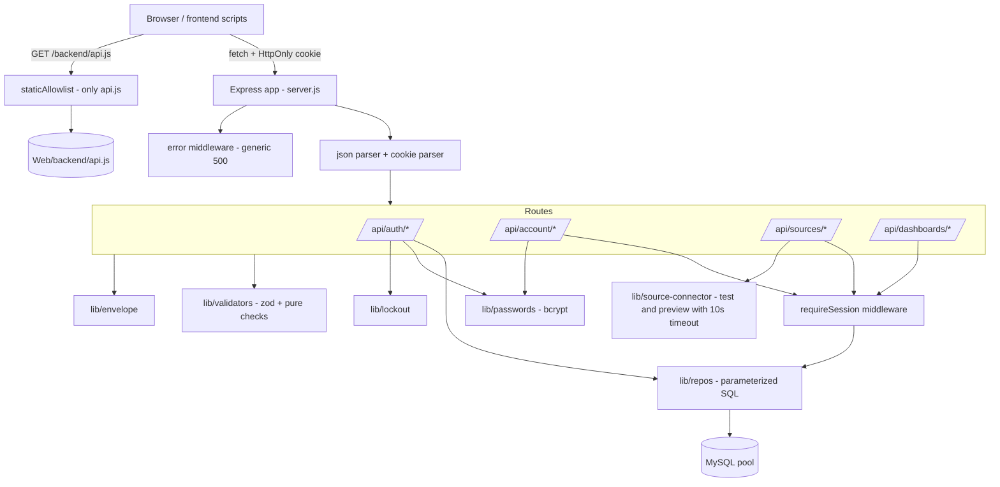

# Design Document

## Overview

This design implements the Auth, Account, Sources, and Dashboards endpoints listed in `Web/backend/server.js`, plus a fetch client in `Web/backend/api.js`. The stack is Node.js (CommonJS, matching the existing `require` style), Express 5, the existing `mysql` package, `zod` (already installed) for validation, and `bcrypt` (new dependency).

Key design decisions:

| Decision | Rationale |
|---|---|
| Split logic into small CommonJS modules under `Web/backend/lib/` and keep `server.js` as the wiring file | Pure functions (validators, hashing, lockout, envelope, image sniffing) can be property-tested without a database or HTTP server. The rules name only `server.js` and `api.js`, but the existing file layout does not forbid helper modules. |
| Replace the single `mysql.createConnection` with `mysql.createPool`, wrapped in a small promise helper (`db.query`, `db.withTransaction`) | A single connection cannot run concurrent requests or transactions safely. Requirements 2.6, 5.5 and 12.3 need transactions. |
| Opaque random session tokens, stored as SHA-256 hashes in a `sessions` table | Allows revocation (Requirement 4, 9.4, 12) and avoids storing usable tokens. JWTs cannot be revoked without a table anyway. |
| Reset and email-confirmation tokens: 32 random bytes, only the SHA-256 hash stored | Requirement 5.2. A database leak does not expose usable tokens. |
| `bcrypt` (native) with cost 12 | Requirement 1.1 requires cost at least 10. Tests override cost to 4 through an options argument for speed; one separate test asserts the production default. |
| Source keys stored encrypted (AES-256-GCM, key from `SOURCE_KEY_SECRET`) | Test and preview calls (Requirement 14.6, 14.8) need the full key later, so it cannot be hashed. Only `key_last4` is ever returned. |
| Login lockout kept in a `login_attempts` table | Survives restarts and works if more than one server process runs. The counting logic is a pure function over attempt rows plus a clock. |
| Every route handler gets `req.userId` from the session middleware only | Requirement 13.1. Repository functions take `userId` as a required first argument, so a query without an owner condition cannot be written by accident. |
| `api.js` is a factory `createApiClient({ fetchImpl, baseUrl })` that also exports a default instance, written to load both in Node (CommonJS) and in the browser (global) | Lets tests inject a fake `fetch`, and lets pages load the same file from `/backend/api.js`. See "api.js and browser use" below. |
| Avatar bytes are served by `GET /api/account/avatar`, and profiles carry only the Avatar_URL `/api/account/avatar?v=<epoch seconds>` | Keeps large `data:` URLs out of JSON. The `v` value changes with each update so browsers refetch, while the route always reads the avatar of the session user and ignores `v`. |
| `/backend/` is served by a small allowlist handler, not `express.static` | `express.static` serves any file in the directory, including `server.js`. An exact-match allowlist containing only `api.js` makes disclosure of other files impossible by construction. |

New environment variables: `SOURCE_KEY_SECRET` (32 bytes, base64) and optional `APP_BASE_URL` (used to build reset and confirmation links). Startup fails with a message naming the missing variable for any of `DB_HOST`, `DB_USER`, `DB_PASSWORD`, `DB_NAME`, `SOURCE_KEY_SECRET` (Requirement 16.6).

### Research findings that informed the design

- bcrypt only uses the first 72 bytes of its input. Newer `bcrypt` releases do not throw on longer input, so the design rejects over-72-byte passwords before hashing (Requirement 1.5) and measures length with `Buffer.byteLength(p, 'utf8')`, not `string.length`.
- Express 5 forwards rejected promises from async handlers to the error middleware, so handlers do not need try/catch wrappers for the generic 500 path.
- Express 5 `req.body` is `undefined` when no body parser matched, so validators must handle a missing body.
- The `mysql` package has no promise API. A thin wrapper around `pool.query(sql, params, cb)` keeps parameterized placeholders (`?`) as the only way values enter SQL (Requirement 13.5).
- Express decodes `req.path` segments only partly, and `%2f`, `%5c`, and `%00` can survive as encoded text. The static handler therefore reads the raw URL (`req.originalUrl` with the query removed), rejects any encoded or literal traversal character first, then decodes once and compares the result to the allowlist (Requirement 18.6, 18.7).
- A response with a stored image type must carry `X-Content-Type-Options: nosniff` and a fixed image `Content-Type`, so a stored file cannot be interpreted as HTML or script by the browser.
- Frontend `Web/frontend/scripts/editor/api.js` already sends `credentials: 'same-origin'`, expects `{ success, data, error }`, validates ids with `^[A-Za-z0-9_-]{1,64}$`, and assumes 404 for foreign ids. This design matches those conventions.

## Architecture



Request flow for a protected route: parse JSON, parse cookie, `requireSession` hashes the cookie token and looks up an unrevoked, unexpired session joined to its user, sets `req.userId` and `req.sessionId` (or returns 401 without any other query), then the handler validates input, calls repositories with `req.userId`, and replies through the envelope helpers.

### File layout

```
Web/backend/
  server.js            wiring: config check, pool, middleware, route mounting, listen
  api.js               fetch client (createApiClient)
  lib/
    config.js          env check (16.6)
    db.js              pool, query(), withTransaction()
    envelope.js        ok(), fail(), errorMiddleware
    passwords.js       hashPassword, verifyPassword, byte-length rules
    validators.js      zod schemas + pure validators
    session.js         token creation/hash, cookie build/parse, isSessionValid
    lockout.js         pure lockout evaluation
    tokens.js          reset/email token creation, hashing
    image.js           detectImageType, mimeFor, size check, avatarUrl
    static-allowlist.js  /backend/ handler: allowlist, path rejection rules
    crypto-box.js      encrypt/decrypt source keys, last4
    repos/             users, sessions, tokens, sources, dashboards
    source-connector.js  testSource, previewSource
    routes/            auth.js, account.js, sources.js, dashboards.js
db/schema.sql          table definitions (below)
```

Route modules export `function(deps) { return express.Router() }` so tests can pass fake repositories.

## Components and Interfaces

### Envelope (`lib/envelope.js`)

- `ok(res, status, data)` sends `{ success: true, data }`.
- `fail(res, status, error)` sends `{ success: false, error }` with a non-empty string and no `data` key.
- `errorMiddleware(err, req, res, next)` logs `err` server-side, then sends `fail(res, 500, 'Internal server error')`. Errors created with `new HttpError(status, message)` keep their status and message. Any other error becomes the generic 500 text, so SQL text, stack traces, paths, and credentials never reach the client (16.3, 16.4).
- A JSON-parse failure from `express.json()` maps to 400 through the same middleware.
- Two successful responses are raw bytes and bypass `ok()`: `GET /api/account/avatar` (image bytes) and `GET /backend/api.js` (script text). Their failures still use `fail()` (16.1).

### Password hasher (`lib/passwords.js`)

```js
hashPassword(plain, { cost = 12 } = {}) -> Promise<string>
verifyPassword(plain, hash)             -> Promise<boolean>   // never throws; false for bad hash
byteLength(str)                         -> number
checkPasswordRules(plain, { min })      -> { ok: true } | { ok: false, reason: 'missing'|'too_short'|'too_long' }
DUMMY_HASH                              // valid bcrypt hash computed at startup, used for timing equalization
```

`verifyPassword` returns false when `hash` is null, not a string, or not a valid bcrypt hash (1.7). Signup, reset, and change-password use `min = 10`; login and the current-password check use `min = 1`. Minimum length is counted in bytes everywhere, which resolves the "characters" wording in 5.6 and 9.3 to the same byte rule used in 2.2.

### Session helpers (`lib/session.js`)

```js
newSessionToken()                 -> { token, tokenHash }     // 32 random bytes, base64url; SHA-256 hex
buildSessionCookie(token)         -> 'sid=...; HttpOnly; SameSite=Lax; Max-Age=604800; Path=/'
buildClearCookie()                -> 'sid=; HttpOnly; SameSite=Lax; Max-Age=0; Path=/'
parseCookies(header)              -> { [name]: value }
isSessionValid(session, now)      -> boolean   // not revoked AND expires_at > now
```

The cookie also gets `Secure` when `NODE_ENV === 'production'`. Sessions expire 7 days after creation.

### Lockout (`lib/lockout.js`)

```js
evaluateLockout(attempts, now) -> { locked: boolean, retryAfterSeconds: number }
// attempts: array of { at: ms, success: boolean } for one identifier, any order
```

Rule: sort attempts by time and drop everything up to and including the latest success. In the remaining run of failures, find the first 5 consecutive failures that all fall within one 15-minute window. The identifier is locked when such a group exists and its 5th failure happened less than 15 minutes before `now`. `retryAfterSeconds = ceil((fifthFailureAt + 15min - now) / 1000)`. Identifiers are lowercased and trimmed before use. Requests rejected with 400 for malformed input record nothing (3.6). Attempts during lockout return 429 and are not themselves recorded as failures, so the lockout ends exactly 15 minutes after the 5th failure.

### Validators (`lib/validators.js`)

Pure functions returning `{ ok: true, value }` or `{ ok: false, fields: { name: message } }`, so the error text can name each invalid field (2.3, 16.5):

- `validateSignup(body)`: username (trim, lowercase, `^[a-z0-9_]{3,24}$`), email (trim, at most 254, `^[^\s@]+@[^\s@.]+(\.[^\s@.]+)+$`-style rule, stored lowercase), displayName (trim, 1 to 60), password (not trimmed, 10 to 72 bytes).
- `validateLogin(body)`: identifier string 1 to 254, password string 1 to 72 bytes.
- `validateEmail(str)`, `validateUsername(str)`, `validateDisplayName(str)`, `validateNewPassword(str)`.
- `validateProfile`, `validatePreferences` (`defaultChart` in the editor's chart set `line|bar|pie|kpi|table`, `refreshRate` integer 0 to 86400), `validateChangePassword` (rules 9.3 and 9.5), `validateChangeEmail`.
- `validateSourceInput` (name 1 to 100, `type` in `excel|scrape|logs|rest|sql|json`, key non-empty up to 512).
- `isValidId(id)` using `^[A-Za-z0-9_-]{1,64}$`.
- `validateDashboardDefinition(def)` uses a zod schema mirroring the editor's `normalizeDashboard` output: `{ name: string (max 120), grid: { columns: 24|48|72|96, showGrid: boolean }, widgets: Widget[] (max 200) }`. Each widget has `id`, `type` from the widget types, layout `{ x, y, w, h }` integers, a `config` object, and `bindings[]` of `{ sourceId, xField, yField, agg }`. The schema is `.strict()` on the top level so unknown keys are rejected, and `collectSourceIds(def)` returns the distinct `bindings[].sourceId` values for the ownership check in 15.7. The frontend `model.js` already clamps `name` and `columns`, so valid editor output always passes.

### Image detection (`lib/image.js`)

`detectImageType(buffer) -> 'png' | 'jpeg' | 'webp' | null`, from magic bytes only: PNG `89 50 4E 47 0D 0A 1A 0A`, JPEG `FF D8 FF`, WebP `RIFF....WEBP`. `mimeFor(type)` maps to `image/png`, `image/jpeg`, `image/webp`. `checkAvatar(buffer)` returns `missing` for 0 bytes, `too_large` above 2,097,152 bytes, `unsupported` when type is null, else `{ type, mime }`. `avatarUrl(avatarUpdatedAt)` returns `null` when the value is null, else `/api/account/avatar?v=${avatarUpdatedAt}` where the value is an integer count of seconds since the epoch (6.7 to 6.9). The route uses `express.raw({ type: () => true, limit: '2mb' })` on this one route and maps the body-parser "entity too large" error to 400 too large. The client file name and content type are ignored (8.5).

### Static allowlist handler (`lib/static-allowlist.js`)

```js
STATIC_ALLOWLIST = new Set(['api.js'])
resolveStaticRequest(rawUrl, method) -> { file: 'api.js' } | { reject: true }
staticAllowlist({ dir, allowlist = STATIC_ALLOWLIST }) -> express middleware
```

`resolveStaticRequest` is a pure function, so the path rules can be property-tested without a server. It works on the raw URL, in this order:

1. Method other than GET or HEAD: reject (18.8).
2. Strip the query string and the `/backend/` prefix. An empty remainder (a directory such as `/backend/`) or a remainder ending in `/` is rejected (18.5).
3. Reject if the raw remainder contains `..`, a backslash, `%00`, or a case-insensitive `%2e%2e`, `%2f`, `%5c` (18.6).
4. Decode once with `decodeURIComponent` (a decoding error rejects). Reject again if the decoded text contains `/`, `\`, a null byte, or `..`.
5. Accept only when the decoded name is an exact, case-sensitive member of the allowlist (18.4, 18.7). A name that starts with `.`, `server.js`, and anything under `lib/` fail here.

The middleware is mounted before the JSON parser and the session middleware, so no Session is needed (18.3). On accept it reads `path.join(dir, file)` with `fs.readFile` and sends 200 with `Content-Type: application/javascript; charset=utf-8` and `X-Content-Type-Options: nosniff` (18.2). It never calls `express.static`, `res.sendFile` with a client-derived path, or `fs.readdir`. On every reject, and when the allowlisted file cannot be read, it sends the same fixed 404 body (`Not found`, as a Response_Envelope failure) so a missing file and a forbidden file look identical (18.9). A rejected request never falls through to a directory index, so no listing is possible (18.5, 18.10).

### Source key box (`lib/crypto-box.js`)

`encryptKey(plain) -> string`, `decryptKey(blob) -> string`, `last4(plain) -> string` (the last four characters, or the whole key if shorter than four).

### Source connector (`lib/source-connector.js`)

`testSource(source) -> Promise<{ status: 'ok'|'failed', reason? }>` and `previewSource(source) -> Promise<Row[]>`, both wrapped in a 10-second timeout (`Promise.race` with `AbortController` where the transport supports it). Connection logic is dispatched on `source.type`. The first version implements `rest` and `json` (HTTP fetch of a URL with the key as bearer token or query value as configured) and returns `failed` / 502 with a clear reason for types whose connectors are not yet built. Preview is capped to 100 rows. Outbound URLs for `rest`, `json`, and `scrape` are validated to `http`/`https` and blocked for loopback, link-local, and private address ranges to avoid server-side request forgery.

### Repositories (`lib/repos/*`)

Each function takes `userId` first and puts `owner_id = ?` (or `user_id = ?`) in every SELECT, UPDATE, and DELETE (13.2). Examples:

```js
sources.list(userId)                       // SELECT ... WHERE owner_id = ?
sources.get(userId, id)                    // WHERE id = ? AND owner_id = ?
dashboards.update(userId, id, def)         // UPDATE ... WHERE id = ? AND owner_id = ?
sessions.revokeAllExcept(userId, keepId)   // UPDATE sessions SET revoked_at = NOW() WHERE user_id = ? AND id <> ?
```

Lookups by token hash (sessions, reset, email confirm) and by identifier at login are the only queries without a user id, because they are how the user id is discovered. Reset and confirmation updates then add `user_id = ?` using the id from the token row.

### Routes

Auth (no session required)

| Route | Behavior |
|---|---|
| `POST /api/auth/signup` | Validate, hash, `INSERT` into `users`. Unique indexes on `username_lc` and `email_lc` enforce 2.4 and 2.6. A duplicate-key error (`ER_DUP_ENTRY`) maps to 409 naming the conflicting field from the index name. Create a session in the same transaction, set cookie, 201 with public profile. |
| `POST /api/auth/login` | Validate, check lockout, look up user by `username_lc` or `email_lc`. Always run `verifyPassword` (against `DUMMY_HASH` when the user is unknown). Failure records an attempt and returns 401 with one generic message. Success clears the attempt history, creates a session, sets cookie, 200. |
| `POST /api/auth/logout` | If a valid session exists, set `revoked_at`. Always clear the cookie. 200. On database error: still clear the cookie, 500. |
| `POST /api/auth/forgot-password` | Validate email (400 on bad). If user exists: mark earlier unused tokens used, insert new token (hash, 30 minute expiry), log link `${APP_BASE_URL}/pages/login.html?reset=<token>` to the console (no mail service configured). Always respond 200 with the same body. |
| `POST /api/auth/reset-password` | Validate password rules first (so a bad password leaves the token unused, 5.6), then in one transaction: `UPDATE reset_tokens SET used_at = NOW() WHERE token_hash = ? AND used_at IS NULL AND expires_at > NOW()`. If `affectedRows` is 0, roll back and return 400. Otherwise update `password_hash` and revoke all sessions of that user, commit, 200. The conditional UPDATE makes single use safe under concurrent requests. |

Account (all behind `requireSession`)

| Route | Behavior |
|---|---|
| `GET /api/account` | One query joining `users` with `COUNT(sources)` for `req.userId`, selecting `avatar_updated_at` but not the avatar bytes. `avatarUrl` is `avatarUrl(avatar_updated_at)`: the Avatar_URL or `null`, never a `data:` URL (6.7 to 6.9). 404 if no row. |
| `PATCH /api/account/profile` | Validate, `UPDATE users SET display_name, username, username_lc WHERE id = ?`. `ER_DUP_ENTRY` returns 409. |
| `PUT /api/account/avatar` | `express.raw`, `checkAvatar`, then one `UPDATE users SET avatar = ?, avatar_mime = ?, avatar_updated_at = UNIX_TIMESTAMP() WHERE id = ?`, replacing any earlier avatar. 200 with `{ avatarUrl }` (8.1, 8.8). |
| `GET /api/account/avatar` | Behind `requireSession`, so no query runs without a Session (4.2, 8.15). One query `SELECT avatar, avatar_mime FROM users WHERE id = ?` using `req.userId` only; the `v` query value and any other client-supplied id are never read (8.13). No avatar: 404 through `fail()` (8.14). Otherwise send 200 with the raw bytes, `Content-Type` set to the stored mime, `X-Content-Type-Options: nosniff`, and `Cache-Control: private, no-cache` (8.9 to 8.12). The stored mime is one of three constants written by the server, never client text. |
| `DELETE /api/account/avatar` | Set `avatar`, `avatar_mime`, and `avatar_updated_at` to NULL. 200 even when none was set. |
| `POST /api/account/password` | Validate (400 rules), `verifyPassword(current)` (403 on mismatch), hash and update, then `revokeAllExcept(userId, req.sessionId)`. |
| `POST /api/account/email` | Validate, verify password (403), check `email_lc` not used by anyone including the user (409), insert token (24 hour expiry, bound to user and new email), log link. |
| `GET /api/account/email/confirm?token=` | In a transaction, consume the token with a conditional UPDATE. If the new email now belongs to another user: token stays marked used, 409. Otherwise update email. This route accepts a token rather than a session so the link works from an email client, and the token itself binds the user id. |
| `PATCH /api/account/preferences` | Validate, update `preferences` JSON column. |
| `POST /api/account/sessions/revoke-all` | Revoke all sessions for the user, clear the cookie. |
| `DELETE /api/account` | `withTransaction`: delete dashboards, sources, sessions, reset tokens, email tokens, login attempts are keyed by identifier and are cleared by username and email, then the user row. Commit, clear cookie, 200. On error: rollback, 500, no `Set-Cookie`. |

Sources and Dashboards follow the table in Requirements 14 and 15. Both reject malformed `:id` with 400 before any query (14.10), return the same 404 body for foreign and missing ids (`fail(res, 404, 'Not found')`), and wrap results in the envelope. `GET /api/dashboards/:id/data` loads the dashboard, loads only sources owned by the user for the referenced ids, and runs `previewSource` per widget binding, returning `{ [widgetId]: rows | { error } }`.

Dashboard ids and source ids are generated server-side as `dash_` / `src_` plus 16 random base64url characters, which satisfies the id regex.

### Public views

`toPublicProfile(userRow)` returns `{ username, displayName, email, avatarUrl, preferences, sourceCount }` and never copies other columns. `avatarUrl` is computed from `avatar_updated_at` only; the avatar bytes and mime columns are not read into the view. `toSourceView(row)` returns `{ id, name, type, status, keyLast4, lastSyncAt }`. Using explicit allow-lists (not deleting fields from the row) means a new column can never leak by default (1.8, 6.3, 14.4).

### api.js client

```js
createApiClient({ fetchImpl = globalThis.fetch, baseUrl = '' }) -> {
  signup(body), login(body), logout(), forgotPassword(body), resetPassword(body),
  getAccount(), updateProfile(body), putAvatar(blob), deleteAvatar(),
  changePassword(body), changeEmail(body), confirmEmail(token), updatePreferences(body),
  revokeAllSessions(), deleteAccount(),
  getAvatar(),                                  // resolves with a Blob
  listSources(), createSource(body), deleteSource(id), testSource(id), previewSource(id),
  listDashboards(), createDashboard(body), getDashboard(id), updateDashboard(id, body),
  deleteDashboard(id), getDashboardData(id)
}
```

That is 27 functions, one per endpoint in `server.js` including `GET /api/account/avatar` (17.1). A shared `request(method, path, body, { as = 'json' })`:

1. Sends `fetchImpl(baseUrl + path, { method, credentials: 'same-origin', headers, body })`. `headers` is `{ 'Content-Type': 'application/json' }` and `body` is `JSON.stringify(body)` only when a body is given; otherwise both are omitted (17.2 to 17.4). `putAvatar` sends the `Blob` as is with its own content type, since the server detects the type from content; this is the one function that does not send JSON.
2. A thrown fetch error rejects with `ApiError('Cannot reach the server', undefined)` and no status (17.8).
3. For `as: 'blob'` (only `getAvatar`): when `res.ok`, resolve with `await res.blob()` and skip envelope parsing (17.10). When not `res.ok`, fall through to the envelope handling below, which rejects with the status and the envelope's `error`, or the invalid-response message when the body is not an envelope (17.11).
4. Otherwise the response text is parsed as JSON. A failure, or a parsed value that is not an object with a boolean `success`, rejects with `ApiError('Invalid response from server', status)` (17.7).
5. `res.ok && envelope.success === true` resolves with `envelope.data`. Anything else rejects with `ApiError(envelope.error || fallback, status)` (17.5, 17.6).
6. Path ids go through `encodeURIComponent` (17.9). `confirmEmail` also encodes its token query value.

`ApiError` has `status` (number or `undefined`) and `message`.

**api.js and browser use.** `api.js` is served to browsers at `/backend/api.js` by the static allowlist handler, which exposes that one file only. The file must therefore run as a plain browser script and as a CommonJS module. It ends with a guard: `if (typeof module !== 'undefined' && module.exports) { module.exports = { createApiClient, ApiError, api }; } else { globalThis.KiroApi = { createApiClient, ApiError, api }; }`. It uses no `require` and no Node-only API, and contains no secrets, because it is public. A page loads it with `<script src="/backend/api.js"></script>` and calls `KiroApi.api.getAccount()`. The default instance uses `baseUrl = ''` and `credentials: 'same-origin'`, so the cookie is sent. Editing the existing frontend pages to call it (replacing the mock in `scripts/accounts.js`) is not part of this design's file changes.

## Data Models

```sql
CREATE TABLE users (
  id             BIGINT UNSIGNED AUTO_INCREMENT PRIMARY KEY,
  username       VARCHAR(24)  NOT NULL,
  username_lc    VARCHAR(24)  NOT NULL,
  email          VARCHAR(254) NOT NULL,
  email_lc       VARCHAR(254) NOT NULL,
  display_name   VARCHAR(60)  NOT NULL,
  password_hash  VARCHAR(100) NOT NULL,
  avatar            MEDIUMBLOB NULL,
  avatar_mime       VARCHAR(16) NULL,
  avatar_updated_at BIGINT UNSIGNED NULL,
  preferences    JSON NOT NULL,
  created_at     DATETIME NOT NULL DEFAULT CURRENT_TIMESTAMP,
  UNIQUE KEY uq_users_username (username_lc),
  UNIQUE KEY uq_users_email (email_lc)
);

CREATE TABLE sessions (
  id          BIGINT UNSIGNED AUTO_INCREMENT PRIMARY KEY,
  user_id     BIGINT UNSIGNED NOT NULL,
  token_hash  CHAR(64) NOT NULL UNIQUE,
  created_at  DATETIME NOT NULL DEFAULT CURRENT_TIMESTAMP,
  expires_at  DATETIME NOT NULL,
  revoked_at  DATETIME NULL,
  INDEX (user_id),
  FOREIGN KEY (user_id) REFERENCES users(id) ON DELETE CASCADE
);

CREATE TABLE reset_tokens (
  id          BIGINT UNSIGNED AUTO_INCREMENT PRIMARY KEY,
  user_id     BIGINT UNSIGNED NOT NULL,
  token_hash  CHAR(64) NOT NULL UNIQUE,
  expires_at  DATETIME NOT NULL,
  used_at     DATETIME NULL,
  INDEX (user_id),
  FOREIGN KEY (user_id) REFERENCES users(id) ON DELETE CASCADE
);

CREATE TABLE email_tokens (
  id          BIGINT UNSIGNED AUTO_INCREMENT PRIMARY KEY,
  user_id     BIGINT UNSIGNED NOT NULL,
  new_email   VARCHAR(254) NOT NULL,
  token_hash  CHAR(64) NOT NULL UNIQUE,
  expires_at  DATETIME NOT NULL,
  used_at     DATETIME NULL,
  INDEX (user_id),
  FOREIGN KEY (user_id) REFERENCES users(id) ON DELETE CASCADE
);

CREATE TABLE login_attempts (
  id          BIGINT UNSIGNED AUTO_INCREMENT PRIMARY KEY,
  identifier  VARCHAR(254) NOT NULL,
  success     TINYINT(1) NOT NULL,
  at          DATETIME(3) NOT NULL DEFAULT CURRENT_TIMESTAMP(3),
  INDEX (identifier, at)
);

CREATE TABLE sources (
  id           VARCHAR(64) PRIMARY KEY,
  owner_id     BIGINT UNSIGNED NOT NULL,
  name         VARCHAR(100) NOT NULL,
  type         VARCHAR(20)  NOT NULL,
  status       VARCHAR(10)  NOT NULL DEFAULT 'untested',
  key_enc      TEXT NOT NULL,
  key_last4    VARCHAR(4) NOT NULL,
  last_sync_at DATETIME NULL,
  created_at   DATETIME NOT NULL DEFAULT CURRENT_TIMESTAMP,
  INDEX (owner_id),
  FOREIGN KEY (owner_id) REFERENCES users(id) ON DELETE CASCADE
);

CREATE TABLE dashboards (
  id          VARCHAR(64) PRIMARY KEY,
  owner_id    BIGINT UNSIGNED NOT NULL,
  name        VARCHAR(120) NOT NULL,
  definition  JSON NOT NULL,
  updated_at  DATETIME NOT NULL DEFAULT CURRENT_TIMESTAMP ON UPDATE CURRENT_TIMESTAMP,
  INDEX (owner_id),
  FOREIGN KEY (owner_id) REFERENCES users(id) ON DELETE CASCADE
);
```

The `ON DELETE CASCADE` clauses are a safety net. `DELETE /api/account` still deletes each table explicitly inside one transaction, as Requirement 12.3 states. `schema.sql` is committed at `Web/backend/db/schema.sql`; no migration tool is added.

The dashboard `definition` column holds the validated definition without `id` and `updatedAt`; the response adds them. `dashboards.name` duplicates `definition.name` so list queries do not parse JSON.

The three avatar columns are either all NULL (no avatar) or all set. `avatar_mime` holds one of `image/png`, `image/jpeg`, `image/webp`, taken from content sniffing. `avatar_updated_at` stores epoch seconds as an integer, so the Avatar_URL version value needs no time-zone conversion. `MEDIUMBLOB` holds up to 16 MB, and the 2,097,152 byte limit is enforced in code. The MySQL `max_allowed_packet` setting must be at least 3 MB for the upload to succeed.

Default preferences on signup: `{ "defaultChart": "line", "refreshRate": 0 }`.

Response shapes (inside the envelope `data`):

- Profile: `{ username, displayName, email, avatarUrl|null, preferences: { defaultChart, refreshRate }, sourceCount }`, where `avatarUrl` is `/api/account/avatar?v=<epoch seconds>` or `null`
- Avatar upload result: `{ avatarUrl }`
- `GET /api/account/avatar` success: raw image bytes, not an envelope
- Source: `{ id, name, type, status, keyLast4, lastSyncAt|null }`
- Dashboard: `{ id, definition, updatedAt }`; list item: `{ id, name, updatedAt }`

## Correctness Properties

*A property is a characteristic or behavior that should hold true across all valid executions of a system-essentially, a formal statement about what the system should do. Properties serve as the bridge between human-readable specifications and machine-verifiable correctness guarantees.*

Reflection notes: the avatar header checks (8.10 to 8.12) are folded into the avatar round-trip property (Property 19). Avatar selection by session user (8.13) is covered by Property 11's isolation scope. The path-rejection rules 18.4 to 18.8 collapse into one property over the pure resolver (Property 21), and 18.9 with 18.10 into one no-disclosure property (Property 22). Password length rules from 1.5, 1.6, 2.2, 5.6, and 9.3 share one byte-length validator and are combined into Property 3. Profile leakage checks from 1.8, 6.3, and 14.4 are combined into Property 5. Signup field rules from 2.2, 2.3, and 2.5 are one property. The two timing and concurrency requirements (3.4, 2.6) and all database-error paths are covered as integration tests, not properties.

### Property 1: bcrypt round trip

*For any* password of 10 to 72 bytes, the stored hash is a bcrypt string with cost at least 10 that does not contain the plaintext, and `verifyPassword(password, hash)` is true. *For any* two different passwords `p` and `q` in that range, `verifyPassword(q, hashPassword(p))` is false.

**Validates: Requirements 1.1, 1.2, 1.3, 1.4**

### Property 2: Invalid stored hashes never verify

*For any* string, `null`, `undefined`, or non-string value used as the stored hash that is not a valid bcrypt hash, and *for any* password, `verifyPassword` returns false and does not throw.

**Validates: Requirements 1.7**

### Property 3: Password length rules are measured in bytes

*For any* string (including multi-byte characters), `checkPasswordRules(s, { min: 10 })` is ok exactly when `10 <= byteLength(s) <= 72`, returns `too_long` when it exceeds 72 bytes, and `too_short` or `missing` otherwise; with `min: 1` the empty string is `missing` and all strings of 1 to 72 bytes are ok.

**Validates: Requirements 1.5, 1.6, 2.2, 5.6, 9.3**

### Property 4: Signup validation and normalization

*For any* signup body, `validateSignup` accepts it exactly when username matches `^[a-z0-9_]{3,24}$` after trimming and lowercasing, email passes the email rule and is at most 254 characters after trimming, display name is 1 to 60 characters after trimming, and password is 10 to 72 bytes. On rejection, the `fields` result names every invalid field. On acceptance, username and email in the result are lowercase and trimmed, and the password is unchanged.

**Validates: Requirements 2.2, 2.3, 2.5**

### Property 5: Public views never expose secrets

*For any* user row (with arbitrary password hash, avatar bytes, and extra columns) and any source row (with an arbitrary key), `toPublicProfile` and `toSourceView` return only their allow-listed keys, and the JSON text of the result contains neither the password hash nor the full source key (only the last four characters of the key may appear).

**Validates: Requirements 1.8, 6.3, 14.4**

### Property 6: Login lockout state machine

*For any* sequence of timestamped login attempts (successes and failures) and any current time, `evaluateLockout` reports locked exactly when the failures after the most recent success include 5 consecutive failures within a 15-minute window and the 15 minutes after the 5th have not elapsed. When locked, `retryAfterSeconds` equals the remaining seconds, rounded up, and is between 1 and 900. Appending a success at any time after the attempts leaves the identifier unlocked.

**Validates: Requirements 3.5, 3.7**

### Property 7: Session validity

*For any* session record and time `now`, `isSessionValid` is true exactly when the session is not revoked and `expires_at` is later than `now`.

**Validates: Requirements 4.3**

### Property 8: Reset tokens are single use

*For any* user, any issued reset token, and any two valid new passwords `p1` and `p2`: applying the token with `p1` succeeds and all of the user's sessions are revoked; applying the same token again with `p2` fails with 400 and the stored hash still verifies `p1` and does not verify `p2`. *For any* token that is unknown, expired, or superseded by a later token for the same user, applying it fails with 400 and leaves the password hash unchanged.

**Validates: Requirements 5.2, 5.5, 5.7, 5.8**

### Property 9: Avatar type comes from content

*For any* byte buffer, `detectImageType` returns `png`, `jpeg`, or `webp` exactly when the buffer starts with the matching signature, regardless of any file name or declared content type, and `mimeFor` maps those to `image/png`, `image/jpeg`, `image/webp`. `checkAvatar` returns `missing` for an empty buffer, `too_large` for more than 2,097,152 bytes, `unsupported` for other content, and a type with its mime otherwise.

**Validates: Requirements 8.1, 8.2, 8.3, 8.4, 8.5**

### Property 10: Preferences validation

*For any* value pair for `defaultChart` and `refreshRate`, `validatePreferences` accepts exactly when `defaultChart` is a string in the known chart set and `refreshRate` is an integer from 0 to 86400 inclusive; on rejection it names which field is invalid.

**Validates: Requirements 11.1, 11.2**

### Property 11: Per-user isolation

*For any* two distinct users A and B with arbitrary sources and dashboards, and any sequence of read, update, and delete operations performed as A (with ids drawn from both users' rows and from nonexistent ids): B's rows are never returned and never modified, and every operation on an id belonging to B returns a response status and body byte-identical to the response for a nonexistent id.

**Validates: Requirements 13.1, 13.2, 13.3, 13.4, 14.11, 15.9**

### Property 12: Id validation

*For any* string, `isValidId` is true exactly when it matches `^[A-Za-z0-9_-]{1,64}$`, and any source or dashboard route called with an id for which it is false returns 400 without running a query.

**Validates: Requirements 14.10**

### Property 13: Dashboard round trip

*For any* valid dashboard definition owned by a user whose referenced sources are all owned by that user, creating the dashboard and then reading it returns a definition deeply equal to the submitted one, and a PATCH with another valid definition followed by a read returns the new definition.

**Validates: Requirements 15.2, 15.3, 15.4, 15.10**

### Property 14: Envelope format

*For any* status code and payload, success responses made with `ok()` have exactly the shape `{ success: true, data }`, and failure responses (including failures of the avatar GET and the static route) have `success: false`, a non-empty string `error`, and no `data` key. The raw-byte successes of `GET /api/account/avatar` and `GET /backend/api.js` are the only exceptions.

**Validates: Requirements 16.1, 16.2, 16.5**

### Property 15: Unexpected errors are generic

*For any* error thrown inside a handler, whose message and stack may contain SQL text, file paths, hostnames, or credentials, the error middleware responds with status 500 and the fixed generic message, and the response body contains none of the error's message, stack, or the configured database values.

**Validates: Requirements 16.3, 16.4**

### Property 16: Client request shape

*For any* client function and any valid arguments, the single fetch call uses the HTTP method listed for its endpoint, `credentials: 'same-origin'`, and, when a body is supplied, a `Content-Type: application/json` header with `JSON.stringify(body)`; when no body is supplied, no body and no content-type are sent.

The set of client functions covers each of the 27 endpoints exactly once, including `getAvatar` with method GET.

**Validates: Requirements 17.1, 17.2, 17.3, 17.4**

### Property 17: Client result mapping

*For any* HTTP status and response text, for every function other than `getAvatar`, the client resolves with the envelope's `data` exactly when the status is 2xx and the text parses to an envelope with `success: true`. For a parsed failure envelope or a non-2xx status it rejects with an error whose `status` equals the HTTP status and whose message is the envelope's `error`. For text that is not a valid envelope it rejects with the response status and an invalid-response message. When `fetch` itself throws, it rejects with a cannot-reach-server message and no status.

For `getAvatar`, *for any* 2xx status and body bytes, it resolves with a Blob holding those bytes; *for any* non-2xx status it rejects with that status and the envelope's `error`, or the invalid-response message when the body is not an envelope.

**Validates: Requirements 17.5, 17.6, 17.7, 17.8, 17.10, 17.11**

### Property 18: Client id encoding

*For any* id string, including ones containing `/`, `?`, `#`, and `%`, the request URL for any id-bearing client function has the id as one path segment: parsing the URL yields the expected number of segments, no query or fragment introduced by the id, and `decodeURIComponent` of that segment equals the original id.

**Validates: Requirements 17.9**

### Property 19: Avatar round trip and response headers

*For any* byte buffer that is a valid PNG, JPEG, or WebP of 1 to 2,097,152 bytes, storing it with `PUT /api/account/avatar` and then calling `GET /api/account/avatar` as the same user returns HTTP 200 with a body byte-identical to the stored buffer, `Content-Type` equal to the mime for the content-sniffed type, `X-Content-Type-Options: nosniff`, and `Cache-Control: private, no-cache`. This holds whatever file name or content type the upload declared.

**Validates: Requirements 8.1, 8.5, 8.9, 8.10, 8.11, 8.12, 8.16**

### Property 20: Avatar URL format

*For any* integer `t` of seconds since the epoch, `avatarUrl(t)` equals `/api/account/avatar?v=` followed by the decimal digits of `t`, and `avatarUrl(null)` is `null`. *For any* user row, the profile's `avatarUrl` is either that value or `null`, and never starts with `data:`.

**Validates: Requirements 6.7, 6.8, 6.9, 8.8**

### Property 21: Static route serves only the allowlist

*For any* request path under `/backend/` and any HTTP method, `resolveStaticRequest` accepts exactly when the method is GET or HEAD and the raw path (query removed) is `api.js` or an encoding that decodes once to exactly `api.js`. *For any* path containing `..`, `%2e%2e` in any letter case, `%2f`, `%5c`, `%00`, or a backslash, for any directory path, for any name beginning with `.`, for any name that differs from `api.js` in case, and for `server.js` or any path under `lib/`, it rejects.

**Validates: Requirements 18.1, 18.2, 18.4, 18.5, 18.6, 18.7, 18.8**

### Property 22: Static route does not disclose other files

*For any* request path under `/backend/` other than `/backend/api.js`, the response is HTTP 404 with a body identical to the fixed 404 body (the same for existing and nonexistent names), and the body contains no byte sequence from `server.js` or any file under `lib/`. A request to `/backend/api.js` without a Session cookie returns HTTP 200 with the file contents.

**Validates: Requirements 18.3, 18.9, 18.10**

## Error Handling

| Condition | Status | Notes |
|---|---|---|
| Body fails validation | 400 | `error` lists each invalid field, e.g. `Invalid fields: username, email` |
| Malformed JSON body | 400 | From `express.json()` error, mapped in middleware |
| Missing, expired, or revoked session on protected route | 401 | Checked before any other query |
| Wrong login credentials | 401 | Single generic message |
| Wrong current password (change password, change email) | 403 | |
| Unknown or foreign resource id | 404 | Identical body: `Not found` |
| Duplicate username or email | 409 | `ER_DUP_ENTRY` mapped by index name |
| Login lockout | 429 | `Retry-After` header in seconds |
| Avatar upload is empty, over 2,097,152 bytes, or not PNG/JPEG/WebP | 400 | Distinct messages; existing avatar kept |
| `GET /api/account/avatar` and user has no avatar | 404 | Envelope failure, no bytes |
| Any rejected `/backend/` request (non-allowlisted, directory, traversal, bad method) | 404 | Same fixed body for all, whether or not the file exists |
| Source unreachable on preview | 502 | No rows |
| Anything unexpected | 500 | Generic message; details written to the server log only |

Specific rules:

- Logging never includes request bodies, passwords, hashes, tokens, or source keys. Only the method, path, status, and error object (with those fields scrubbed) are logged.
- Multi-statement operations (signup with session, reset password, email confirm, delete account) run inside `withTransaction`, which rolls back on any thrown error and rethrows.
- The static handler decodes the path once, and a malformed percent sequence is a reject (404), not a 500. A read error on `api.js` also returns the fixed 404 body and is logged server-side only.
- Logout clears the cookie even when revocation fails (4.6). Delete-account failure leaves the cookie untouched (12.5).
- Forgot-password returns the same 200 body for known and unknown emails, and does the same amount of work in both branches except the insert, so the response does not disclose account existence.
- Source test failures and timeouts are not HTTP errors: the route returns 200 with status `failed` and a short reason (14.7). The reason text is built from a fixed set of messages, not raw exception text.

## Testing Strategy

Requirements-first coverage uses two layers.

**Property-based tests** use `fast-check` (add as a dev dependency), run with the existing runner (`npm test`, which uses `node --test tests/*.test.mjs`). New file: `tests/auth-account.test.mjs` (the existing tests are ES module `.mjs` files; they import the CommonJS backend modules through default imports). Each property is one `fc.assert(fc.property(...), { numRuns: 100 })` (or `asyncProperty`), tagged with a comment in the form:

`// Feature: auth-account-endpoints, Property N: <title>`

- Properties 1 and 2 call the hasher with `cost: 10`, the minimum allowed by 1.1, to keep runs short. A separate unit test asserts the production default cost is at least 10.
- Properties 3, 4, 5, 6, 7, 9, 10, 12, 14, 20, and 21 test pure functions with no I/O. Property 21 generates paths from a mix of the allowlisted name, near-miss names (case changes, trailing dots, leading dots), traversal strings, and encoded separators.
- Property 22 mounts `staticAllowlist` on a test app pointed at a temporary directory that holds an `api.js` and a fake `server.js` and `lib/secret.js` with unique marker strings, and asserts the markers never appear in any 404 body.
- Properties 8, 11, 13, 19 run the real route modules against in-memory fake repositories implementing the same interface as `lib/repos/*` (a `Map`-backed store), driven through `supertest`-style calls on an Express app built from the route factories. An optional integration run against a test MySQL database repeats Property 11 and 13 with fewer runs (for example 20) to verify the SQL owner conditions.
- Property 15 mounts a route that throws generated errors, with the real error middleware.
- Property 19 uses generated buffers that start with a valid signature followed by random bytes, up to 2,097,152 bytes in a few runs and small sizes in the rest.
- Properties 16, 17, 18 call `createApiClient` with an injected fake `fetchImpl`.

**Unit and integration tests (example-based)** cover the rest:

- Signup: 201 with cookie; 409 for duplicate username and email (case-insensitive); concurrent duplicate signups create one row; database error leaves no user (2.1, 2.4, 2.6, 2.7).
- Login: success cookie attributes (3.2); identical 401 body for unknown user and wrong password; average timing difference under 100 ms over 20 requests each (3.4); 429 with `Retry-After` on the sixth attempt, including with the correct password (3.5); 400 does not count as a failure (3.6).
- Logout and sessions: 401 after logout; logout with no session returns 200; revoke-all; delete-account cascades and rolls back on injected failure (4, 12).
- Forgot-password: byte-identical responses for known and unknown emails; link is written to the console via a spy (5.1, 5.4).
- Avatar: PUT rejects empty, oversized (2,097,153 bytes), and non-image input with 400 and keeps the old avatar; accepts exactly 2,097,152 bytes; DELETE twice returns 200 both times; GET returns 404 with an envelope when none is set, 401 with no Session and no bytes; the `v` parameter and a foreign user id in the query do not change which avatar is returned (8.2 to 8.4, 8.6, 8.7, 8.13 to 8.15). `GET /api/account` returns `null` with no avatar and the Avatar_URL after upload, and the `v` value changes after a second upload made at a later second (6.7, 6.8).
- Static route: `GET /backend/api.js` returns 200 with a JavaScript Content-Type and no cookie; `/backend/`, `/backend/lib/`, `/backend/server.js`, `/backend/.env`, `/backend/%2e%2e/server.js`, `/backend/lib%2fx.js`, and `/backend/api.js%00` return the fixed 404; POST to `/backend/api.js` returns 404 (18.2 to 18.9). A smoke test loads `api.js` in a `vm` context with no `module` and no `require` and checks that `KiroApi.createApiClient` exists.
- Email change flow including the conflict-at-confirm case (10).
- Sources: 201 with `untested`; 400 cases; test and preview with a stubbed connector, including the 10-second timeout using fake timers; 502 on preview failure (14).
- Dashboards: 7 and 8 rejection cases (foreign source id, schema failure); GET after DELETE returns 404 (15).
- Smoke: startup with a missing environment variable logs the variable name and does not listen (16.6); a grep-style test asserts no template-literal or concatenated SQL in `Web/backend` (13.5).

**Why not property tests everywhere.** Database behavior (unique indexes, transactions), HTTP timing, console output, and cookie flags do not vary meaningfully with input, so they are tested with a few examples rather than 100 random runs.

**Dependencies to add:** `bcrypt` (runtime), `fast-check` (dev). Supertest is optional; tests can instead call the app on an ephemeral port with `fetch`.
