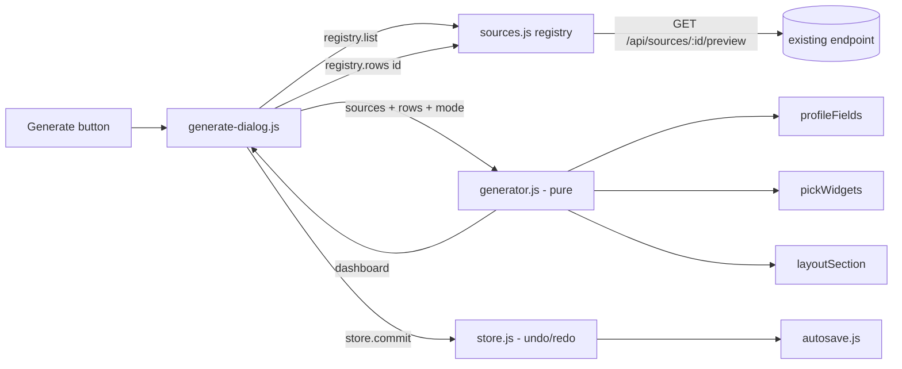

# Design Document

## Overview

The Generator turns the preview rows of one or more Sources into a ready-made dashboard. It is a pure ES module, `Web/frontend/scripts/editor/generator.js`, with no DOM access and no network calls. A small editor module, `generate-dialog.js`, collects the user's choices, loads rows through the existing source registry and commits the result to the store.

Key design decisions:

| Decision | Rationale |
|---|---|
| Generate in the browser from the rows the editor already fetches | The editor already caches preview rows per source (`sources.js`). Reusing them means no new endpoint, no extra source fetch, no schema change, and nothing new to secure on the server. |
| Rule-based heuristics, no LLM | Output is deterministic and explainable, works offline, costs nothing per run, and can be property-tested. An optional AI pass can be layered on later because the Generator's output is an ordinary dashboard document. |
| Output is a normal dashboard document that `normalizeDashboard` leaves unchanged | Editor, autosave, viewer and public view need no special cases (Requirement 4.1). |
| Widget ids come from an injected `makeId` function | Lets tests make ids predictable and proves determinism (Requirement 4.2, 4.4). The editor passes `uid` from `dom.js`. |
| One store commit per generation | One Undo reverts the whole generation (Requirement 5.4). |
| Profiling lives in the Generator, not in `data.js` | `fieldsOf` stays as is for the inspector. The Generator needs richer Roles (time, category, text, empty) and reuses `data.js` only for number parsing. |
| Code style follows the neighbouring editor modules (camelCase, K&R braces, `export function`) | The editor's ES modules don't use the `tmp`/`p` prefixes from `format.md`, which the backend follows. Matching the files around it keeps the editor consistent. |

## Architecture



### File layout

```
Web/frontend/scripts/editor/
  generator.js         NEW  pure: profileFields, generateSection, generateDashboard
  generate-dialog.js   NEW  DOM: dialog, loading, confirmation, commit
  main.js              wire the Generate button and dialog
Web/frontend/pages/edit.html     toolbar button + <dialog id="generate-dialog">
Web/frontend/style/edit.css      dialog styles (reuse the source dialog's classes)
tests/generator.test.mjs         unit tests
tests/generator-pN-<name>.test.mjs   property tests (fast-check)
```

## Components and Interfaces

### `profileFields(rows) -> FieldProfile[]`

```js
/** @typedef {'time'|'number'|'category'|'text'|'empty'} Role */
/** @typedef {{ name: string, role: Role, distinct: number, presentCount: number }} FieldProfile */
```

Rules, applied in this order per Field over the Sample (first 100 plain-object Rows):

1. No Present_Values → `empty`.
2. Name matches `/^id$|_id$|[a-z]Id$/` → `text` (Requirement 1.7).
3. Every Present_Value is a string matching `ISO_DATE` or `SLASH_DATE` and `Date.parse` succeeds → `time`.
   - `ISO_DATE = /^\d{4}-\d{2}-\d{2}([T ]\d{2}:\d{2}(:\d{2}(\.\d+)?)?(Z|[+-]\d{2}:?\d{2})?)?$/`
   - `SLASH_DATE = /^\d{4}\/\d{2}\/\d{2}$/`
   - Numbers are never `time` (Requirement 1.8).
4. Every Present_Value is numeric under `toNumber` from `data.js` → `number`. `toNumber` gets exported from `data.js` for this; its behaviour doesn't change.
5. `2 <= distinct <= 12` and `distinct <= presentCount / 2` → `category`.
6. Otherwise → `text`.

`distinct` counts `String(value)` values. Field order is first-seen order across the Sample, the same as `fieldsOf`.

### `generateSection(source, rows, { columns, makeId }) -> Widget[]`

Picks widgets (Requirement 2), then lays them out starting at `y = 0` (Requirement 3).

Picking, with `N` = `number` fields, `T` = first `time` field, `C` = first `category` field:

| Widget | When | Bindings |
|---|---|---|
| label | always | none; `text: source.name` |
| kpi × up to 3 | `N.length > 0` | `{ yField: n, agg: T ? 'last' : 'sum' }`, title = field name |
| kpi (count) | `N.length === 0 && rows.length > 0` | `{ yField: '', agg: 'count' }`, title `Rows` |
| line | `T && N.length > 0` | one per `N[0..2]`: `{ xField: T, yField: n, agg: 'sum' }` |
| bar | `C && N.length > 0` | `{ xField: C, yField: N[0], agg: 'sum' }` |
| bar (count) | `C && N.length === 0` | `{ xField: C, yField: '', agg: 'count' }` |
| pie | `C && C.distinct <= 6 && N.length > 0` | same as bar |
| table | `rows.length > 0` | `{ sourceId }` only |
| text | `rows.length === 0` | `body: 'This source returned no rows.'` |

The largest possible section is 8 widgets (label, 3 KPIs, line, bar, pie, table), which is under the cap of 10 (Requirement 2.11).

Every binding has all four keys `{ sourceId, xField, yField, agg }`, with `''` for unused ones, because `normalizeBinding` produces exactly that shape (Requirement 4.1). Each config starts from `structuredClone(WIDGET_TYPES[type].defaults)` and overrides only what the table names, so normalization adds no keys. Titles and text are cut to 80 characters (`MAX_NAME`), for the same reason.

**Layout.** Widgets are grouped into bands: `[label]`, `[kpis]`, `[line, bar, pie]`, `[table | text]`, skipping empty bands. Every band has at most 3 widgets, so each band is widened to the full width (Requirement 3.3):
- For a band of `k` widgets, `w_i = floor(columns / k)`, and the last widget also gets the remainder.
- `x` accumulates left to right.
- Each widget's `h` is its `scaleSize` height, and band height is the maximum `h` in the band.
- The next band starts at `y + bandHeight`.

Bands never overlap and every `x + w` is at most `columns` by construction (Requirement 3.4, 3.5).

### `generateDashboard(current, inputs, { mode, makeId }) -> { dashboard, error }`

- `inputs`: `[{ source: { id, name }, rows }]`, in selection order.
- `mode: 'replace'`: the widgets are the sections stacked, each starting at the previous section's bottom.
- `mode: 'append'`: the same, offset by `max(y + h)` over `current.widgets` (0 if there are none).
- `name` and `grid` are copied from `current` (Requirement 4.5).
- If the resulting widget count is over 200, the function returns `{ dashboard: current, error: 'too_many_widgets' }` (Requirement 4.6).
- It never mutates `current`, `inputs` or any `rows` (Requirement 4.3).

### `generate-dialog.js`

`createGenerateDialog({ dialog, openButton, registry, store, makeId, notify, openAddSource })`:
- **On open:** renders a checkbox per `registry.list()` source and preselects all of them when there are 3 or fewer. It defaults the mode from `store.get().widgets.length` (Requirement 5.2). It moves focus to the first checkbox.
- **No sources:** shows the empty message and an "Add source" button that calls `openAddSource()`, and disables Generate (Requirement 5.3).
- **On submit:**
  1. Set the busy state.
  2. `Promise.allSettled(selected.map(s => registry.rows(s.id)))`.
  3. Collect the rejected sources for the skip message (Requirement 5.5).
  4. If the mode is `replace` and there are widgets, `confirm()` first (Requirement 5.6).
  5. Call `generateDashboard`.
  6. On success, `store.commit(dashboard, { label: 'Generate' })`; autosave already listens to the store (Requirement 5.9).
  7. Close the dialog.
- A native `<dialog>` with `showModal()` closes on Escape. The `close` handler returns focus to `openButton` (Requirement 5.8).

## Data Models

There are no new persisted models. The Generated_Dashboard is the existing document:

```js
{ name, grid: { columns, showGrid }, widgets: [{ id, type, x, y, w, h, config }] }
```

## Correctness Properties

Each property is a `fast-check` test in its own file, `tests/generator-pN-<name>.test.mjs`, starting with `// Feature: dashboard-generator, Property N: <title>`. Row arbitraries mix numbers, numeric strings, ISO dates, short repeated labels, long unique strings, `null`, `''`, missing keys and non-object rows.

| # | Property | Validates |
|---|---|---|
| 1 | Profiling is total: one profile per sampled field, in first-seen order, Role in the five allowed values | 1.1, 1.9, 1.10 |
| 2 | Identifier-named fields are never `number` or `time`; bare numbers are never `time` | 1.7, 1.8 |
| 3 | Every binding's `sourceId` is the section's source, and every non-empty `xField` and `yField` exists in that source's sample | 2.10 |
| 4 | Bounds: `0 <= x`, `x + w <= columns`, `w >= 1`, `h >= 1`, `y >= 0` for all 4 column options | 3.4 |
| 5 | No two widgets overlap | 3.5 |
| 6 | `normalizeDashboard(generated)` deep-equals `generated` | 4.1 |
| 7 | Determinism: two runs with the same inputs and a counter-based `makeId` are deep-equal | 4.2 |
| 8 | Immutability: inputs deep-equal a `structuredClone` taken before the call | 4.3 |
| 9 | Append: every new widget's `y` is at least the old bottom edge, and the old widgets are unchanged | 3.7 |
| 10 | Section size is at most 10 widgets; a result over 200 widgets returns `too_many_widgets` with `current` unchanged | 2.11, 4.6 |

## Error Handling

| Case | Behaviour |
|---|---|
| A source preview rejects (502, timeout) | Skip it, generate from the rest, `notify('Skipped: <names>')`. If every source failed, show an error in the dialog and commit nothing. |
| Over the 200-widget limit | Show "This would add too many widgets. Try Replace instead." and commit nothing. |
| A source returns zero rows | Normal output: label + "no rows" text (Requirement 2.9). |
| Non-object rows or odd values | Ignored or profiled as `text`; the Generator never throws on row content. |

## Testing Strategy

- **Unit tests** (`tests/generator.test.mjs`): fixed fixtures for the common shapes:
  - a time series (date + revenue + orders)
  - a category table (region + sales)
  - logs (timestamp + level + message)
  - only text
  - empty rows
  - identifier columns

  Each asserts the exact widget types and bindings from the table above.
- **Property tests**: Properties 1–10 above, run with `npm test`.
- **Manual check in the editor:** generate from each of the six source types once; check undo, replace confirmation, append placement and keyboard use of the dialog.
