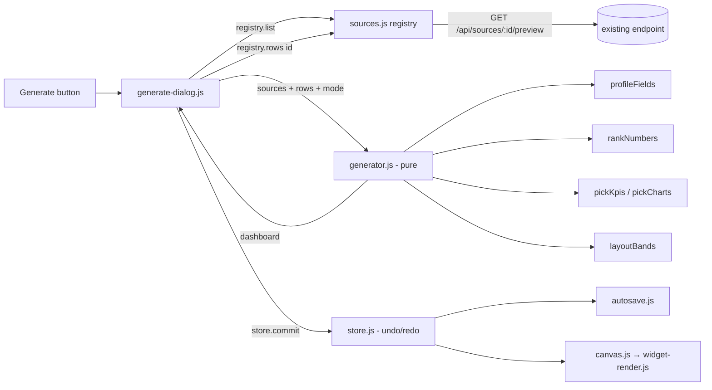

# Design Document

## Overview

The Generator turns the preview rows of one or more Sources into a ready-made dashboard. It is a pure ES module, `Web/frontend/scripts/editor/generator.js`, with no DOM access and no network calls. A small editor module, `generate-dialog.js`, collects the user's choices, loads rows through the existing source registry and commits the result to the store.

Key design decisions:

| Decision | Rationale |
|---|---|
| Generate in the browser from the rows the editor already fetches | The editor already caches preview rows per source (`sources.js`). Reusing them means no new endpoint, no extra source fetch, no schema change, and nothing new to secure on the server. |
| Rule-based heuristics, no LLM | Output is deterministic and explainable, works offline, costs nothing per run, and can be property-tested. An optional AI pass can be layered on later because the Generator's output is an ordinary dashboard document. |
| Output is a normal dashboard document that `normalizeDashboard` leaves unchanged | Editor, autosave, viewer and public view need no special cases (Requirement 4.1). Every widget carries `bindings` (even label/text) and every binding has all four keys, because that is exactly what normalization produces. |
| Widget ids come from an injected `makeId` function | Lets tests make ids predictable and proves determinism (Requirement 4.2, 4.4). The editor passes `uid` from `dom.js`. |
| One store commit per generation | One Undo reverts the whole generation (Requirement 5.4). |
| Profiling lives in the Generator, not in `data.js` | `fieldsOf` stays as is for the inspector. The Generator needs six Roles and reuses `data.js` only for number parsing (`toNumber`, now exported). |
| A `label` Role beside `category` | Real sources are full of one-row-per-thing text columns: APP2's `Category` (11 values in 11 rows), `Month` ("June", "July"), APP1's clock times (`14:05`). Under a plain cardinality rule they are free text and the board gets no chart. A label is a usable axis; ordered labels (months, clock times) get a line, others a bar. |
| Ordered labels may repeat; unordered labels must be unique | APP1's history feed samples every 30 seconds, so each `HH:MM` appears twice (31 distinct in 60 rows). Requiring uniqueness for those would lose the chart. For arbitrary strings, uniqueness is what tells a label from free text. |
| Coded numbers need a code-like name or 0/1 values | HTTP `status` and `up` flags must never be summed. A pure "integer + low cardinality" rule would also catch real measures like `units` or `orders`, so the name hint (or the 0/1 pattern) is required, which keeps the rule testable. |
| Gauge vs flow aggregation | Summing `cpuPct` or `Net Worth ($)` across rows is meaningless; summing `bytes` or `Spending ($)` is right. Rates and stocks show the latest value on an ordered axis (average otherwise for rates); flows sum. In charts, where an x value can repeat, rates average and stocks take the last value. |
| KPI ranking | The first three numbers in column order are often the least useful (APP1 metrics: `cpuPct`, `cores`, `memTotalMb`). Ranking rates, totals/counts and money first surfaces `cpuPct`, `memPct`, `diskPct`. |
| Charts need at least 2 rows | A one-row source (APP1 metrics) would otherwise get a single-point line. Its useful view is KPIs and the row itself. |
| `reverseData` flag instead of sorting | The Generator does not control the order the renderer draws rows in; the renderer groups rows in first-seen order. A newest-first feed (APP1 logs) therefore needs a widget-level flag that the renderer honours, which also makes `last` mean the newest row. The flag has a `false` default on `line` and `kpi` so normalization stays a no-op, and the inspector exposes it. |
| Field names over 120 characters are skipped | `normalizeBinding` cuts `xField`/`yField` at 120, which would silently break a binding (Requirement 1.10). |
| Code style follows the neighbouring editor modules (camelCase, K&R braces, `export function`) | The editor's ES modules don't use the `tmp`/`p` prefixes or Allman braces from `steering/format.md`, which the backend follows. Matching the files around it keeps the editor consistent. |

## Architecture



### File layout

```
Web/frontend/scripts/editor/
  generator.js         NEW  pure: profileFields, rankNumbers, generateSection, generateDashboard
  generate-dialog.js   NEW  DOM: dialog, loading, confirmation, commit
  main.js              wire the Generate button and dialog; shortcut guard while it is open
  data.js              export toNumber (behaviour unchanged)
  widget-types.js      reverseData: false default on line and kpi
  widget-render.js     reverse rows when reverseData is set
  inspector.js         "Rows are newest first" toggle on line and kpi
Web/frontend/pages/edit.html     toolbar button + <dialog id="generate-dialog">
Web/frontend/style/edit.css      dialog styles (reuses the source dialog's type cards)
tests/generator.test.mjs               unit tests on real APP1/APP2 shapes
tests/generator-arbitraries.mjs        shared fast-check arbitraries
tests/generator-pN-<name>.test.mjs     property tests
```

## Components and Interfaces

### `profileFields(rows) -> FieldProfile[]`

```js
/** @typedef {'time'|'number'|'category'|'label'|'text'|'empty'} Role */
/** @typedef {{ name: string, role: Role, distinct: number, presentCount: number, ordered: boolean }} FieldProfile */
```

The Sample is the first 100 plain-object Rows. Fields are taken in first-seen order; names over 120 characters are dropped. `distinct` counts `String(value)`. Rules, first match wins:

1. No Present_Values → `empty`.
2. Identifier name (`/^id$/i`, `/_id$/i`, `/[a-z]Id$/`) → `text`.
3. Every value is a string matching `ISO_DATE` or `SLASH_DATE` that `Date.parse` accepts → `time`.
   - `ISO_DATE = /^\d{4}-\d{2}-\d{2}([T ]\d{2}:\d{2}(:\d{2}(\.\d+)?)?(Z|[+-]\d{2}:?\d{2})?)?$/`
   - `SLASH_DATE = /^\d{4}\/\d{2}\/\d{2}$/`
4. Every value is numeric under `toNumber`:
   - coded number → `category`: all integers, `2 <= distinct <= 12`, `distinct <= presentCount / 2`, and (`CODE_HINT` matches the name, or every value is 0 or 1);
   - otherwise → `number`.
   - `CODE_HINT = /(^|_)(status|code|level|type|kind|state)$|[a-z](Status|Code|Level|Type|Kind|State)$/i`
5. At least 2 values, all strings of ≤ 80 chars, ≥ 80% matching `ORDERED_LABEL` → `label`, `ordered: true`.
   - month: `/^(january|…|december|jan|…|dec|sept)\.?( \d{4})?$/i`
   - clock: `/^\d{1,2}:\d{2}(:\d{2})?$/`
6. All strings or booleans, `2 <= distinct <= 12`, `distinct <= presentCount / 2` → `category`.
7. At least 2 values, all strings of ≤ 80 chars, all distinct → `label`, `ordered: false`.
8. Otherwise → `text`.

### `rankNumbers(profiles) -> FieldProfile[]`

`number` profiles sorted stably by tier: 0 rate (`/(pct|percent|%\)?)\s*$/i`), 1 total/count (`/(total|count)\s*$/i`), 2 money (contains `$`), 3 the rest.

### Aggregation

| Field kind | KPI, ordered axis | KPI, no ordered axis | Chart |
|---|---|---|---|
| rate | `last` | `avg` | `avg` |
| stock (`/(balance\|worth\|price\|uptime\|inventory\|stock\|temp)/i`) | `last` | `sum` | `last` |
| anything else (flow) | `sum` | `sum` | `sum` |

The ordered axis is a `time` Field or an ordered `label`.

### `generateSection(source, rows, { columns, makeId, top = 0 }) -> Widget[]`

With `N` = ranked number fields, `T` = first `time`, `C` = first `category`, `L` = first ordered `label` or else first `label`, `R` = sample size, `bar(N)` = first non-rate in `N` (or `N[0]`):

| Widget | Condition | Config / bindings |
|---|---|---|
| `label` | always | `text: source.name` (80 chars) |
| `kpi` × ≤ 3 | `N.length > 0` | `yField: N[i]`, agg per table above, title = field name, `%`/`$` format, `reverseData` when `T` is descending |
| `kpi` "Rows" | `N.length === 0 && R > 0` | `agg: 'count'` |
| `line` | `R >= 2 && T && N` | one binding per `N[0..2]` over `T`, chart agg, `reverseData` when descending |
| `bar` | `R >= 2 && C && N` | `C × bar(N)`, chart agg |
| `pie` | as bar, `C.distinct <= 6` and the agg is `sum` | same fields |
| `bar` + `pie` (count) | `R >= 2 && C && !N` | count rows per `C`; pie only when `C.distinct <= 6` |
| `line` | `R >= 2 && !T && !C && L.ordered && N` | one binding per `N[0..2]` over `L` |
| `bar` | `R >= 2 && !T && !C && L && !L.ordered && N` | `L × bar(N)` |
| `table` "All rows" | `R > 0` | `{ sourceId }`, `agg: 'sum'` (normalization's default) |
| `text` | `R === 0` | `body: 'This source returned no rows.'` |

The largest section is label + 3 KPIs + line + bar + pie + table = 8 widgets, under the cap of 10 (Requirement 2.15). Every config starts from `structuredClone(WIDGET_TYPES[type].defaults)` plus `bindings: []`, then the table's overrides.

**Layout.** Bands `[label]`, `[kpis]`, `[charts]`, `[table | text]`, empty bands skipped, each ≤ 3 widgets and widened to the full width: `w = floor(columns / k)`, the last widget takes the remainder; `h` is the type's `scaleSize` height; the band is as tall as its tallest widget; the next band starts below it. Bounds and no-overlap hold by construction (Requirement 3.4, 3.5).

### `generateDashboard(current, inputs, { mode, makeId }) -> { dashboard, error }`

- `inputs`: `[{ source: { id, name }, rows }]` in selection order; sections stack, each starting at the previous one's bottom.
- `replace`: only the generated widgets. `append`: the current widgets (same objects) followed by the generated ones, starting at the old bottom edge.
- `name` and `grid` copy `current`.
- Errors return `{ dashboard: current, error }`: `no_sources`, `too_many_widgets` (> 200), `too_tall` (a widget would start below `y = 10000`).
- Never mutates `current`, `inputs` or any rows.

### `generate-dialog.js`

`createGenerateDialog({ dialog, openButton, registry, store, makeId, notify, openAddSource })`:
- **On open:** one checkbox per `registry.list()` source, all preselected when there are 3 or fewer. Mode defaults to `replace` on an empty board, `append` otherwise. Focus goes to the first checkbox (or to "+ Add source" when there are none).
- **No sources:** the list and placement are hidden, an empty note offers "+ Add source" (the existing source dialog, stacked on top), and Generate is disabled. A source added from there appears checked.
- **On submit:** busy state (`aria-busy`, inputs and button disabled, "Reading rows…"), `Promise.allSettled` over `registry.rows`, failed sources named; if every source failed, an inline error and no commit. `replace` on a non-empty board asks `confirm()` first; cancelling keeps the dialog open. Then `generateDashboard`, one `store.commit(dashboard, { origin: 'generate' })`, close, and a toast with the count (plus "Skipped …" when some failed).
- Closing during a load bumps a ticket so the late result is dropped. The native `<dialog>` closes on Escape, and `close` returns focus to the Generate button.

### Shortcut guard (`main.js`)

```js
if (els.sourceDialog.open || els.generateDialog.open || isTypingTarget(e.target)) return;
```

### Rendering `reverseData` (`widget-render.js`)

After a data widget's rows load: `if (widget.config.reverseData) rowSets = rowSets.map((rows) => [...rows].reverse());`. The editor and viewer share this renderer, so both honour the flag.

## Data Models

No new persisted models. The Generated_Dashboard is the existing document:

```js
{ name, grid: { columns, showGrid }, widgets: [{ id, type, x, y, w, h, config }] }
```

`line` and `kpi` defaults gain `reverseData: false`. Old dashboards load unchanged because `normalizeDashboard` merges stored config over defaults, and the server's dashboard schema passes unknown config keys through.

## Correctness Properties

Each property is a `fast-check` test in `tests/generator-pN-<name>.test.mjs`, starting with `// Feature: dashboard-generator, Property N: <title>`. Arbitraries (`tests/generator-arbitraries.mjs`) mix numbers, numeric strings, ISO and invalid dates, month names, clock times, short repeated labels, long strings, `null`, `''`, booleans, nested objects, missing keys, identifier and code-like names, a 121-character name, and non-object rows.

| # | Property | Validates |
|---|---|---|
| 1 | Profiling is total: one profile per sampled field (name ≤ 120) in first-seen order; Role is one of six | 1.1, 1.10, 1.11 |
| 2 | Identifier-named fields are `text` (or `empty`); all-number fields are never `time` | 1.3, 1.4 |
| 3 | Every binding's `sourceId` is the section's source; every non-empty `xField`/`yField` exists in the sample | 2.13 |
| 4 | Bounds: `0 <= x`, `x + w <= columns`, `w >= 1`, `h >= 1`, `y >= 0` for 24/48/72/96 columns | 3.4 |
| 5 | No two widgets overlap | 3.5 |
| 6 | `normalizeDashboard(generated)` deep-equals `generated` (replace and append) | 4.1 |
| 7 | Determinism with a counter-based `makeId` | 4.2 |
| 8 | Inputs deep-equal a `structuredClone` taken before the call | 4.3 |
| 9 | Append keeps old widgets (same objects) and puts new ones at or below the old bottom edge | 3.7 |
| 10 | Section ≤ 10 widgets; over 200 returns `too_many_widgets` with `current` unchanged | 2.15, 4.6 |
| 11 | Every non-empty `yField` is a `number` field | 2.14 |

## Error Handling

| Case | Behaviour |
|---|---|
| A source preview rejects (502, timeout) | Skipped; the toast names it. If every source failed, an inline error and no commit. |
| Over 200 widgets / too tall | Inline error suggesting Replace board; no commit. |
| A source returns zero rows | label + "no rows" text (Requirement 2.12). |
| Non-object rows, odd values, long field names | Ignored or profiled as `text`; the Generator never throws on row content. |
| Dialog closed while rows load | The late result is dropped. |

## Testing Strategy

### Unit tests (`tests/generator.test.mjs`)

Fixtures use the real shapes: APP2 sheets copied from `APP2/John_Doe_finance.xlsx`, and APP1 rows from the agent's own simulator (`APP1/agent/simulate.mjs`) and HiBeam's nginx parser (`Web/backend/lib/connectors/logs.js`).

| Fixture | Expected section |
|---|---|
| APP2 Budget vs Actual (`Category` unordered label, `Budget ($)`, `Actual ($)`, `Difference`) | label, 3 summed KPIs (`$` prefix on the money ones), bar Category × Budget ($), table |
| APP2 Net Worth (`Month` ordered label, `Net Worth ($)` stock) | label, KPI `last`, line Month × Net Worth (`last`), table |
| APP2 Monthly Spending (`Spending ($)` flow) | label, KPI `sum`, line `sum`, table |
| APP2 Debts (`APR (%)` rate, two money fields) | label, KPIs APR `avg` with `%`, Balance and Min Payment `sum`; bar Debt × Balance ($); table |
| APP1 history (`time` = `HH:MM` repeating, Pct fields, `load1`) | label, KPIs cpuPct/memPct/diskPct `last`, line over time with three `avg` series, table |
| APP1 metrics (one row) | label, KPIs cpuPct/memPct/diskPct, table; no charts |
| APP1 services (no measures; `status`, `state`, `up` categories) | label, Rows KPI, bar and pie counting by status, table |
| APP1 nginx logs (ISO `time` newest first, `status` coded, `bytes`, `userAgent` category) | label, KPI bytes `sum`, line time × bytes with `reverseData`, bar and pie status × bytes, table; `status` never a `yField` |
| Time series, text only, identifiers only, zero rows | see the test file |

Plus profiling edge cases (bare numbers, invalid dates, identifier names, coded-number hints), ranking, layout bands, replace/append stacking, and the error results.

### Property tests

Properties 1–11, run with `npm test`.

### Browser check

Run with stubbed `/api/*` responses: generate from four sources with one failing (skip toast, 16 components, autosave creates the dashboard), newest-first log line reads oldest → newest, Delete inside the open dialog leaves the selected widget, Escape closes and returns focus, mode defaults to Add below on a non-empty board, one Undo empties the board and Redo restores it, the Replace confirm both ways, the no-sources state, and "+ Add source" stacking the source dialog.
