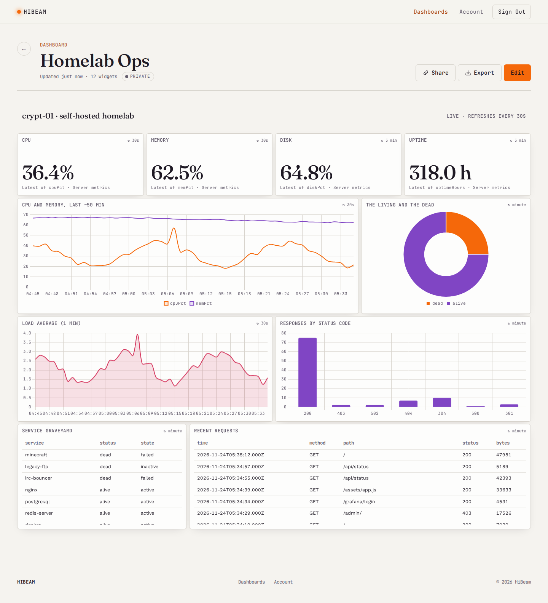

# APP1: Homelab Ops



A live health board for a self-hosted server, built on HiBeam. It shows CPU, memory, disk, load, which services are up, and what the web server has been serving, and it refreshes itself every 30 seconds. Make it public and it doubles as a status page.

This is the "technical user, live data" half of the Skeleton Crew pair. [APP2](../APP2/) is the other half.

## What's in here

| Path | What it is |
|------|------------|
| `agent/agent.mjs` | A small HTTP server with no dependencies. It reads this machine's stats and serves them as JSON for HiBeam |
| `agent/collect.mjs` | The pure parsing and math behind it, covered by `tests/app1-agent.test.mjs` |
| `agent/simulate.mjs` | Demo mode: a made-up homelab whose numbers move, covered by `tests/app1-demo.test.mjs` |
| `agent/.env.example` | Agent config |
| `deploy/hibeam-agent.service` | systemd unit, sandboxed and read-only |
| `deploy/nginx-agent.conf` | nginx `location` block that puts the agent behind your HTTPS site |
| `deploy/caddy-agent.conf` | The same route for Caddy (what our demo server runs) |
| `dashboard.template.json` | The board layout. `{{metrics}}` and the other placeholders are replaced by source ids |

## The agent

| Endpoint | Auth | Returns | HiBeam source |
|----------|------|---------|---------------|
| `/health` | none | `{ ok: true }` | |
| `/metrics` | bearer | one row: `cpuPct`, `memPct`, `diskPct`, `load1/5/15`, `uptimeHours`, ... | REST |
| `/history` | bearer | up to 100 rows, one per sample: `time`, `cpuPct`, `memPct`, `diskPct`, `load1` | REST |
| `/services` | bearer | one row per unit in `SERVICES`: `service`, `status` (`alive`/`dead`), `state` | REST |
| `/logs/access` | bearer | last 100 lines of the nginx access log, with client IPs masked | System logs (`nginx`) |

### Demo mode

Set `AGENT_MODE=demo` and the agent serves a homelab that doesn't exist: `crypt-01`, with 8 cores, 32 GB of RAM and 13 days of uptime. It reads nothing from the machine it runs on. It still moves like a real one:

- CPU follows a daily swell plus a 20-minute "cron" wave and the odd spike. Memory drifts, and disk creeps up and gets pruned weekly.
- `/history` comes back full from the first request, so the charts aren't empty after a restart.
- Three services are permanently dead (the graveyard). `restic-backup` goes down for a few minutes every hour, so the donut changes while you watch.
- The access log is a believable nginx tail. Visitors only ever come from the RFC 5737 documentation ranges, so no real address can appear.

Every value is a pure function of the clock. This is the mode for the judges' board and the demo video.

HiBeam refuses to fetch from localhost or private addresses (that's its SSRF guard), so the agent has to be reachable at a public HTTPS URL. It listens on `127.0.0.1` and nginx proxies to it, so the only way in is through your TLS site with the token.

History lives in memory, so it starts empty when the agent restarts and fills back up at one point per `SAMPLE_SECONDS`.

## Setup

On the server you want to watch (Node 20+):

```bash
git clone <this repo> /opt/hibeam
cd /opt/hibeam/APP1/agent
cp .env.example .env
openssl rand -hex 24          # paste into AGENT_TOKEN
$EDITOR .env                  # set SERVICES, ACCESS_LOG, HOST_LABEL
sudo chown root:root .env && sudo chmod 600 .env   # systemd reads it as root

which node                    # if it isn't /usr/bin/node, fix ExecStart in the unit
sudo cp ../deploy/hibeam-agent.service /etc/systemd/system/
sudo systemctl daemon-reload
sudo systemctl enable --now hibeam-agent
curl -s localhost:9480/health   # {"ok":true}
```

Add `deploy/nginx-agent.conf` to your HTTPS `server { }` block and reload nginx (`sudo nginx -t && sudo systemctl reload nginx`). On Caddy, add `deploy/caddy-agent.conf` to your site block and run `sudo caddy validate --config /etc/caddy/Caddyfile && sudo systemctl reload caddy`. Check it from outside:

```bash
curl -s -H "Authorization: Bearer $TOKEN" https://your-domain.example/hibeam-agent/metrics
```

## Building the board

### With the HiBeam MCP server (how we did it)

With `mcp/hibeam-server.mjs` connected in Kiro, ask:

> Create four REST/logs sources for my homelab agent at https://your-domain.example/hibeam-agent with token `<token>`: metrics, history, services (REST) and logs/access (nginx logs). Test each one, then create a dashboard from APP1/dashboard.template.json with the placeholders swapped for the new source ids.

The agent calls `create_source`, then `test_source`, then `preview_source` to check field names, then `create_dashboard`. `set_dashboard_visibility` turns it into a public status page.

### By hand

1. **Sources**, then **New source**, four times:
   - REST: `.../hibeam-agent/metrics`, auth `Bearer <token>`
   - REST: `.../hibeam-agent/history`, auth `Bearer <token>`
   - REST: `.../hibeam-agent/services`, auth `Bearer <token>`
   - System logs: `.../hibeam-agent/logs/access`, format `nginx`, auth `Bearer <token>`
2. On the dashboards page, click **Import layout**, pick `APP1/dashboard.template.json`, and point `metrics`, `history`, `services` and `logs` at the four sources. Name your sources the same and they're picked for you.

### When the agent goes quiet

The CPU, memory, disk and uptime tiles have a 5-minute "gone quiet" check on the agent's `sampledAt` column. If the agent stops reporting, those tiles fade, their borders go dashed, and a ghost shows when the box was last heard from. If the agent can't be reached at all, every widget on a refresh timer does the same and keeps the last numbers it had. To see it, stop the agent (`systemctl stop hibeam-agent`) and wait for the next refresh.

## Security notes

- **Token:** every data endpoint needs the bearer token, compared in constant time. The agent only listens on loopback, so nginx with TLS is the only way in. Rotate the token by editing `.env`, restarting the agent, and updating the four HiBeam sources.
- **Sandbox:** the agent runs as a throwaway systemd user with no capabilities, a read-only filesystem, no home directories, and only `/var/log/nginx` visible under `/var/log`.
- **Visitor IPs:** the log feed zeroes the last octet of IPv4 addresses and everything after the first 48 bits of IPv6. Anything that doesn't parse as an address is replaced with `-`.
- **Demo mode serves no real data.** It never reads `/proc`, the disk, systemd or any log, and the hostname defaults to `crypt-01`, never the machine's own name. In demo mode you can also delete `SupplementaryGroups=adm`, `TemporaryFileSystem=` and `BindReadOnlyPaths=` from the unit file.
- **Public boards are recon.** This applies in live mode. Service names, uptime and request paths tell an attacker what you run. If you make the board public, use a generic `HOST_LABEL`, only list services you're happy to advertise in `SERVICES`, and drop the two log widgets if your paths are sensitive.
