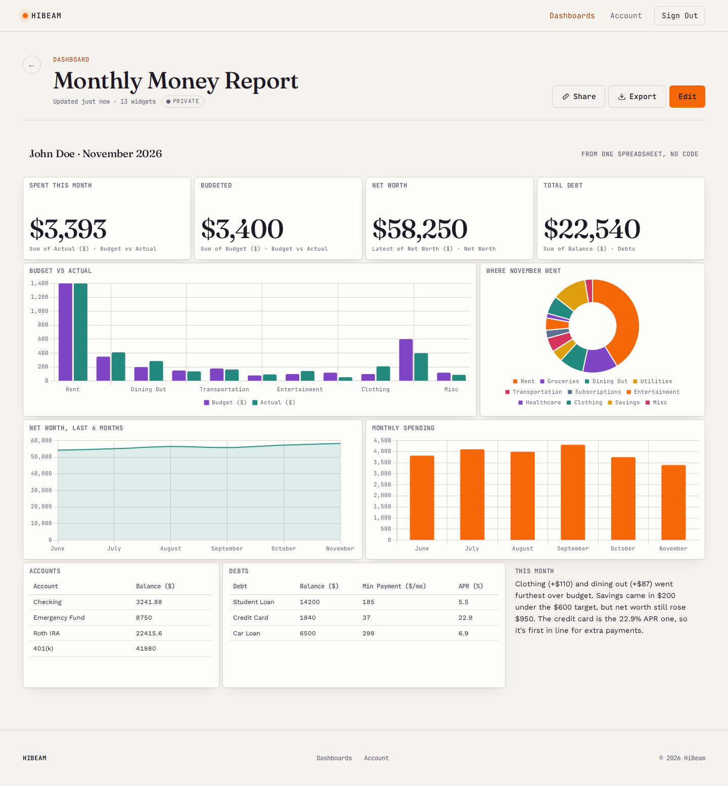

# APP2: Monthly Money Report

A personal finance report built from one spreadsheet. Upload a workbook and you get a board with spending against budget, where the money went, net worth over time, accounts and debts. Export it as a PDF and that's your month-end report.

This is the "non-technical user, uploaded file" half of the Skeleton Crew pair. [APP1](../APP1/) is the opposite: a technical user with live data from a server. The two apps don't share a single source type, and they run on the same HiBeam skeleton with no code changes.

| | APP1 Homelab Ops | APP2 Money Report |
|---|---|---|
| User | Someone who runs servers | Someone with a budget spreadsheet |
| Data | Live REST and log feeds | One uploaded `.xlsx` |
| Updates | Every 30 seconds | When you upload a new month |
| Shared as | A public status page | An exported PDF |

## What's in here

| Path | What it is |
|------|------------|
| `John_Doe_finance.xlsx` | Sample workbook. John Doe is made up, and so is every number |
| `dashboard.template.json` | The board layout. `{{budget}}` and the other placeholders are replaced by source ids |

## The workbook

Each sheet becomes its own HiBeam Excel source. The header row turns into field names.

| Sheet | Columns | Used for |
|-------|---------|----------|
| `Budget vs Actual` | Category, Budget ($), Actual ($), Difference | Spent and budgeted KPIs, budget-vs-actual bars, the donut |
| `Monthly Spending` | Month, Spending ($) | Spending by month |
| `Net Worth` | Month, Net Worth ($) | Net worth KPI and trend |
| `Accounts` | Account, Balance ($) | Accounts table |
| `Debts` | Debt, Balance ($), Min Payment ($/mo), APR (%) | Total debt KPI and debts table |
| `Profile` | Field, Value | Not on the board. It's there for context |

To use your own numbers, keep the sheet names and header rows, replace the rows, and re-upload the file to each source. The charts don't need to change.

## Building the board

### With the HiBeam MCP server (how we did it)

With `mcp/hibeam-server.mjs` connected in Kiro, ask:

> Create an Excel source for each sheet in APP2/John_Doe_finance.xlsx except Profile, upload the workbook to each one, test them, then create a dashboard from APP2/dashboard.template.json with the placeholders swapped for the new source ids.

The agent calls `create_source` with `{ sheet }`, then `upload_source_file`, then `test_source` for each sheet, and finally `create_dashboard`.

### By hand

1. **Sources**, then **New source**, then **Excel**. Pick the workbook and type the sheet name. Do this once for each of the five sheets.
2. Open the editor and lay out the widgets from `dashboard.template.json`, or build your own. KPIs use `sum` for the budget sheet and `last` for net worth.
3. On the view page, **Export** and then **Export as PDF** gives you the month-end report.

## Notes

- The workbook is stored server-side and only parsed there, read-only. Nothing in it runs. Uploads are capped at 5 MB and must be `.xlsx` or `.csv`.
- The donut has 11 categories and HiBeam has 6 chart colours, so some colours repeat. If that bothers you, merge small categories into `Misc`.
- The "This month" text box is written by hand. Update it when you update the numbers.
