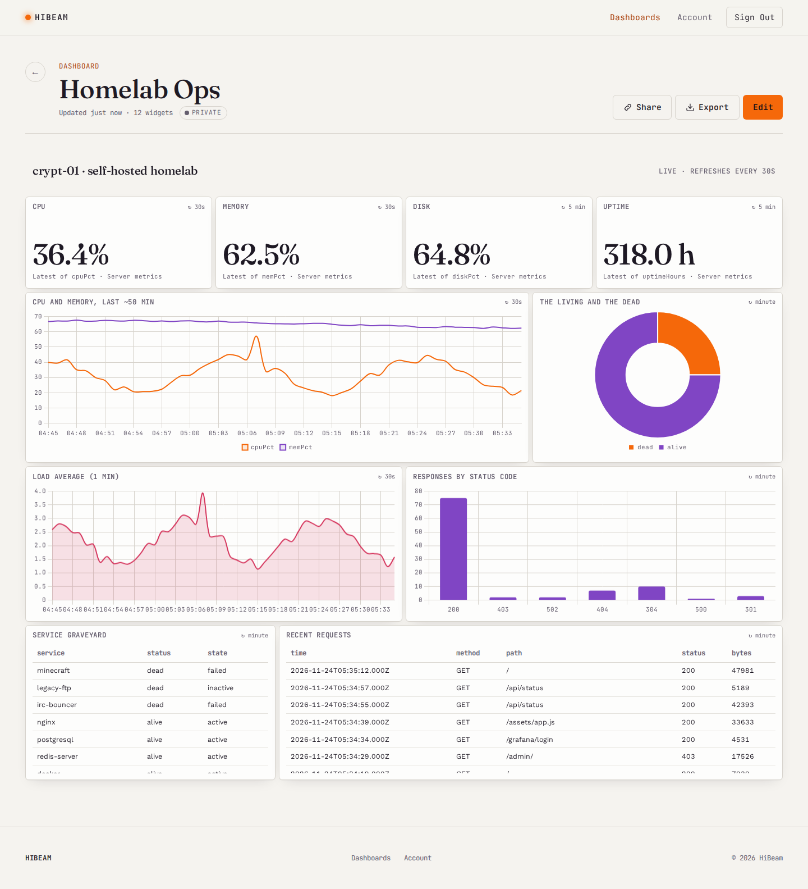
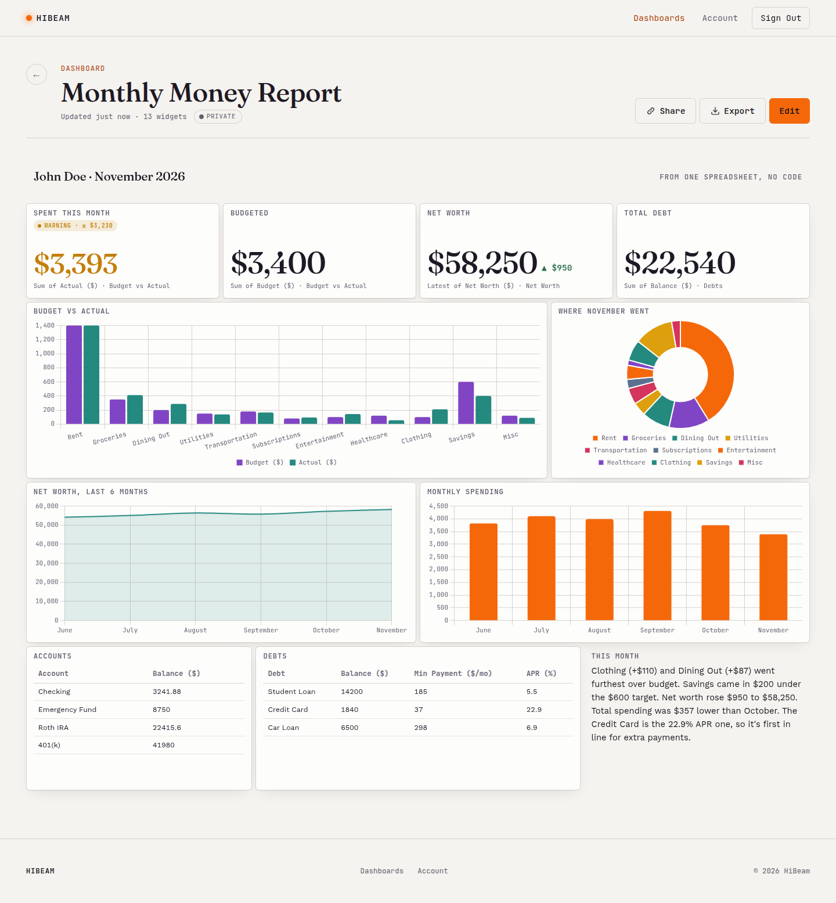
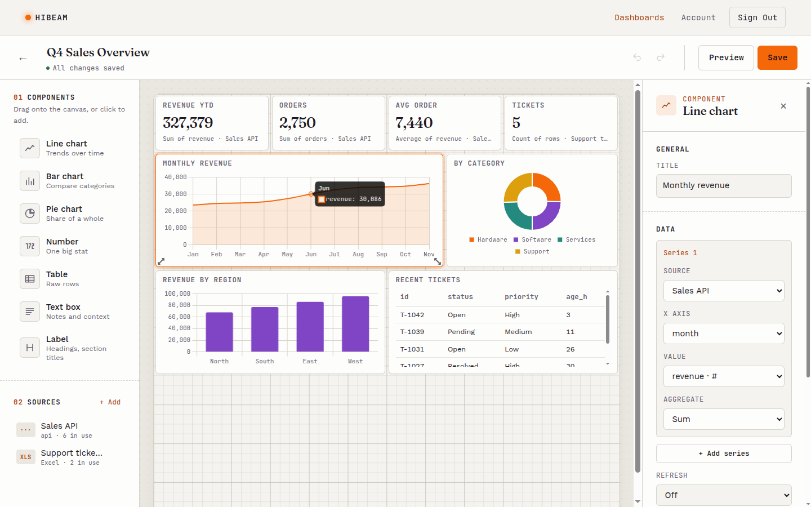

# HiBeam

> **Kiroween Hackathon 2026 · Skeleton Crew**

**You don't build the board. The agent does.** Point Kiro at your data and HiBeam's MCP server lets it connect the sources, read the real rows, and draft a board. HiBeam's rule-based generator gives a reason for every widget ("`cpuPct` is a rate, so show the latest value, never a sum"). Kiro then looks at the result and fixes what reads badly. The board it saves is plain JSON you can review like code. Both applications in this repo were built that way, one prompt each.

Underneath is an ordinary dashboard tool you can also drive by hand: accounts, eight source types, a drag-and-drop editor, a read-only viewer, public links, and PNG/PDF export. Two very different applications are built on top of it, in [`APP1/`](APP1/) and [`APP2/`](APP2/), with no changes to the skeleton.

**Who it's for:** anyone whose numbers live somewhere awkward and who wants them on one page without building a BI stack. That might be a developer watching their own server, someone in an office turning a weekly spreadsheet into a report, or someone tracking their own budget. If your data comes from an API, a database, a log, a web page or a spreadsheet, you can put it on a board, share a link to it, or export it as a PDF.

### Who uses it

| | The homelabber | The spreadsheet keeper | The small-team dev |
|---|---|---|---|
| Has | A box at home or a cheap VPS running a few services, plus nginx logs | A budget or a weekly report in Excel that gets updated by hand | A handful of internal APIs and a MySQL database, and no one assigned to "dashboards" |
| Wants | A page to glance at, and a status page to give friends when something's down | The same numbers as a clean page or a PDF every month, without learning a BI tool | One board the team can open, kept in the repo next to the code |
| Uses | REST and log sources refreshing every 30s, CPU/disk thresholds, a public link, "gone quiet" when the agent stops reporting | One `.xlsx` upload, the generator for a first draft, PDF export | Kiro and the MCP server to draft the board, layouts exported as JSON and reviewed in PRs |
| Built as | [APP1: Homelab Ops](APP1/) | [APP2: Monthly Money Report](APP2/) | This repo's own workflow (see [Built with Kiro](#built-with-kiro)) |

### Why not Grafana or Metabase?

They're both better tools than HiBeam at what they were built for. HiBeam is for the cases where they're more setup than the job needs.

| | HiBeam | Grafana | Metabase |
|---|---|---|---|
| Built for | Small mixed data: an API, a log, a sheet, a web page | Time-series metrics and logs at scale | Asking questions of a SQL database |
| To get started you need | Node and a MySQL/MariaDB database for HiBeam itself | A metrics store (Prometheus, InfluxDB, Loki...) or a plugin per source type | A database to query. CSV uploads also land in a database you connect |
| REST / JSON | Built in | Through a plugin such as Infinity | No native connector |
| Prometheus | Built in (PromQL) | Native, and far deeper | No |
| Excel / CSV | Upload a file, or link a published Google Sheet | Through a plugin | CSV upload into a connected database |
| Scrape a web page | Built in (CSS selector) | No | No |
| First board | **Generate** reads the rows and lays one out, with a reason for each widget | You build each panel | X-rays suggest charts for a table |
| An agent can build it | MCP server and a Kiro power, 17 tools | Possible through its HTTP API | Possible through its HTTP API |
| Share | Public link, PNG, PDF, layout as JSON | Snapshots, public dashboards, PDF reporting in paid tiers | Public links, embedding, subscriptions |
| Where it's stronger than HiBeam | | Alert routing, long retention, millions of points, a huge plugin ecosystem | Ad-hoc queries, joins, permissions for a whole company |

If you already run Prometheus, use Grafana. If your company's data lives in a warehouse, use Metabase. If your numbers are in five different awkward places and you want one page by tonight, that's what HiBeam is for.


---

## Two applications, one skeleton

The two apps are for opposite kinds of user. Between them they cover the skeleton's range: live data and uploaded files, a public share link and a PDF export.

| | [APP1: Homelab Ops](APP1/) | [APP2: Monthly Money Report](APP2/) |
|---|---|---|
| For | Someone running their own server | Someone with a budget spreadsheet |
| Data | REST and nginx log feeds from a small agent on the server | One uploaded `.xlsx` workbook |
| Updates | Every 30 seconds, on its own | When a new month is uploaded |
| Shared as | A public status page | An exported PDF report |
| Ships with | A dependency-free metrics agent, a sandboxed systemd unit, nginx and Caddy configs, a demo mode with simulated data, and the dashboard template (Kiroween theme, CPU/memory/disk alerts) | A sample workbook, the dashboard template, and a monthly import script that re-uploads next month's workbook and rewrites the "This month" summary from the numbers |





Kiro built both boards through HiBeam's own MCP server (see [MCP](#mcp) below), from the `dashboard.template.json` in each app folder. The whole story of how Kiro was used, with the incident behind each hook, is in [`docs/KIRO.md`](docs/KIRO.md).

---

## Features

### Data sources
Every source is fetched server-side, so credentials never reach the browser.

| Type | What it reads |
|------|---------------|
| REST API | JSON from an HTTP endpoint, with an optional bearer token. Nested objects become dotted fields like `user.name` |
| JSON | A JSON file by URL, with an optional array path like `data.items` |
| SQL | A `SELECT` against your own MySQL / MariaDB database, run read-only with a 100-row cap |
| Web scrape | A page plus a CSS selector — tables become columns, other elements become rows |
| System logs | A log file by URL, parsed as JSON lines, nginx, apache, or syslog. Only the end of the file is fetched (`Range`), so big access logs work |
| Excel / CSV | An uploaded `.xlsx` or `.csv` up to 5 MB. **Replace file** swaps in next month's workbook without rebinding any widget |
| CSV link | A CSV by URL, such as a Google Sheets "Publish to web" link. Up to 3 redirects, each one checked against the same private-network block |
| Prometheus | A PromQL query, as the current value or a 1h / 6h / 24h range with one column per series |

### Editor
Drag-and-drop grid with **line, bar, pie, KPI, gauge, uptime strip, table, text, and label** widgets. Autosave, undo/redo, per-widget refresh intervals, and a live preview link.

- **Charts you can tune.** Units on the axis (`$`, `%`, 60k), a "start at zero" switch so a net worth line doesn't look flat, bars sorted with a top N, and pies that fold small slices into "Other". A bar chart with two series can draw one as a line, like the budget over actual spending.
- **Real time on the x axis.** Group a timestamp column by minute, hour, day, week or month. Empty periods stay empty, so an outage shows up as a gap instead of the line jumping straight across it.
- **Reference lines and trends.** Line charts take up to three dashed lines (a CPU limit, a budget target). KPIs can show a small sparkline under the number.
- **Gauge and uptime strip.** A half-donut for a level against a limit, like disk at 82% of 100. The uptime strip gives each service a row of its last 15–90 checks, coloured up/degraded/down, with an uptime %.

- **KPI alerts.** Set a warn and an alert threshold, and say whether higher is good or bad. Past a threshold the number turns amber or red and the card gets a flag. Optionally show the change since the previous row (net worth ▲ $950).
- **Colours that mean something.** Values like `dead`/`alive`, `failed`/`active`, or HTTP 200/404/503 on a status field are coloured by meaning (ok, warn, danger) in charts and tables, not by palette order.
- **Tables never cut a row in half.** They show the rows that fit, plus a "+N more rows" button that switches to scrolling, so exports and screenshots stay clean.
- **"Gone quiet" ghost widgets.** Pick a window (5 minutes to a month) and a timestamp column. When the newest row is older than that, the widget fades, its border goes dashed, and a little ghost says when the source last reported ("No new rows · last heard 14 min ago"). If a refresh fails outright, the widget keeps the last rows it had and says "Can't reach the source" instead of blanking. A dead agent reads as a dead agent, not a board full of zeros.
- **States that say what's wrong.** Each widget has its own loading shimmer, a "Try again" button when a source fails, "No rows yet" when a source comes back empty, and `No "cpuPct" column` when a field it was bound to has disappeared.
- **Themes.** Light, dark, and **Kiroween**. A board can carry its own theme, so a public Kiroween status page looks the same for everyone.

**Generate** builds a board from your sources in one step. It reads each source's rows, works out what every column is (a date, a measure, a category, an axis like months or clock times, an ID, free text), and lays out a heading, up to three KPIs, the charts that fit and a table per source. Percentages and balances show their latest value instead of being summed, status codes and IDs are never added up, and newest-first feeds are flipped so lines read left to right. It's rule-based and runs in the browser, so the same rows always give the same board, and one Undo takes it back.

### Viewer and sharing
A read-only view of any dashboard. Flip it public and anyone with the link can see it without an account. Only the owner can edit.

### Export
From the view page, click **Export** and choose:
- **Export as PNG** — captures the full rendered board at 2× resolution and downloads it as a `.png`.
- **Export as PDF** — wraps the same capture in a PDF page sized exactly to the board and downloads it as a `.pdf`.
- **Layout as JSON** — downloads the board as a `.template.json` with no data in it. Each source id is swapped for a placeholder named after the source, like `{{metrics}}`.

Charts, KPIs, tables, and all widget styles are captured as they appear on screen.

### Templates
**Import layout** on the dashboards page takes any `.template.json`: one you exported, or the ones in [`APP1/`](APP1/dashboard.template.json) and [`APP2/`](APP2/dashboard.template.json). HiBeam lists each placeholder with the widgets and fields it feeds, and picks your source when the names match. Slots you leave empty come in unbound, ready to connect in the editor. So you can rebuild either app's board without Kiro: connect the sources, import the template, done.

### Accounts
Sign up and log in, profile and avatar, email change with confirmation, password reset, preferences, sign-out-everywhere, and account deletion.



---

## Built with Kiro

Everything Kiro uses lives in [`.kiro/`](.kiro/). Here's what's in there and what it did for us.

### Specs
| Spec | What it covers | Status |
|------|----------------|--------|
| [`auth-account-endpoints`](.kiro/specs/auth-account-endpoints/) | Sign-up, login, sessions, lockout, account management, and the static-file allowlist. 18 requirements and 22 numbered correctness properties | Built. 13 of the properties have their own `tests/auth-p*.test.mjs` suite |
| [`dashboard-generator`](.kiro/specs/dashboard-generator/) | A generator that looks at a source's rows, works out each field's type, and proposes a full dashboard layout | Built. 11 properties in `tests/generator-p*.test.mjs`, plus unit tests on the real APP1/APP2 data |
| [`app2-monthly-import`](.kiro/specs/app2-monthly-import/) | APP2's monthly pipeline: check the workbook, re-upload every sheet, and rewrite the month-specific widgets from the numbers with fixed rules | Built. 5 properties in `tests/app2-import-p*.test.mjs`, plus a live run against HiBeam that ended in a PDF export |

The auth spec is where property-based testing paid off. Each property in `design.md` maps to a `fast-check` test, and one of them found an input that crashed the error handler, which the hand-written unit tests had missed.

### Steering
Each doc loads only when it's relevant:

| Doc | Inclusion | What it's for |
|---|---|---|
| [`product.md`](.kiro/steering/product.md) | always | Who it's for, the skeleton rule (apps never change `Web/`), what to optimize for |
| [`tech.md`](.kiro/steering/tech.md) | always | The stack and the commands, so Kiro doesn't reach for a framework we aren't using |
| [`structure.md`](.kiro/steering/structure.md) | always | Where things live |
| [`backend.md`](.kiro/steering/backend.md) | `fileMatch` `Web/backend/**`, `mcp/**` | Naming rules (`tmpVar`, `pParam`, PascalCase, Allman), the envelope, owner scoping. Pulls in `schema.sql` with `#[[file:]]` |
| [`frontend.md`](.kiro/steering/frontend.md) | `fileMatch` `Web/frontend/**` | No build step, `h()` instead of `innerHTML`, tokens for colours, three themes. Pulls in the widget registry |
| [`testing.md`](.kiro/steering/testing.md) | `fileMatch` `tests/**`, specs | How property tests are named and tied to a spec |
| [`security.md`](.kiro/steering/security.md) | manual, `#security` | The short list of rules we've been bitten by, plus the full security-review skill |
| [`mcp.md`](.kiro/steering/mcp.md) | manual, `#mcp` | The build → screenshot → fix loop for making boards, and both app templates |

### Hooks
| Hook | Trigger | What it does |
|------|---------|--------------|
| `session-context` | Session start | Gives every new session the branch, recent commits and uncommitted files |
| `guard-tool-use` | Before a tool runs | Blocks force-pushes and hard resets on `main`, broad `rm -rf`, destructive SQL against the shared database, and any read or write of `.env` |
| `syntax-check-on-save` | Saving a `.js` / `.mjs` file | Runs `npm run check`. Added after a stray quote broke the whole home page and no test loaded that file |
| `api-contract-sync` | Saving a route file | Checks the browser code that calls the route still matches its request and response shapes |
| `spec-consistency` | Saving a spec's `requirements.md` | Checks that `design.md` and `tasks.md` still cover every acceptance criterion |
| `verify-after-task` | Finishing a spec task | Runs the syntax check and the full test suite and fixes what broke before the next task |

### Custom agents
- **`security-reviewer`** checks a diff against the rules this codebase depends on: owner-scoped queries, SSRF guards, read-only SQL sources, the response envelope, no `innerHTML` with user data.
- **`frontend-reviewer`** looks for the frontend bugs that have actually hit this project, plus accessibility, theming and branding.
- **`pbt-writer`** writes `fast-check` property tests in the repo's style.
- **`submission-checker`** audits the repo against the Skeleton Crew rules before submission.

There's also a [`security-review`](.kiro/skills/security-review/SKILL.md) skill with the project's security checklist, which Kiro loads on its own when a change touches routes, connectors, auth or user input.

### MCP

[`mcp/hibeam-server.mjs`](mcp/hibeam-server.mjs) is an MCP server for HiBeam itself, registered with Kiro in [`.kiro/settings/mcp.json`](.kiro/settings/mcp.json). It logs in as a HiBeam account and gives Kiro tools that work on that account's real data:

| Tools | What Kiro can do |
|-------|------------------|
| `list_sources` `create_source` `upload_source_file` `test_source` `preview_source` `delete_source` | Connect data and check what shape it comes back in |
| `list_dashboards` `get_dashboard` `get_dashboard_definition` `create_dashboard` `update_dashboard` `delete_dashboard` | Build and edit whole boards |
| `generate_dashboard` | Draft a board from sources with the rule-based generator, and get a reason for every field (rate, level, flow, category, id). It's a preview unless you pass `create` |
| `get_dashboard_data` `get_public_dashboard_data` `set_dashboard_visibility` `hibeam_status` | Read what a board is showing right now, and share it |

This is how both applications were made. For each one, Kiro created and tested the sources. It previewed rows to get the real field names, then built the board from the app's template. After looking at a screenshot it called `update_dashboard` to fix what read badly. Each board took one prompt, and its layout lives in the repo as JSON, where it gets reviewed like code.

The same tools work on any dashboard, so you can also ask Kiro things like "what is my CPU board showing right now?"

To set it up, copy `mcp/.env.example` to `mcp/.env` and fill in a HiBeam account (a dedicated one is best), with HiBeam running. Kiro starts the server on its own. `autoApprove` is left empty on purpose, so every tool call, including deletes and uploads, waits for your OK.

### Power

[`power-hibeam/`](power-hibeam/) packages the same MCP server as a **Kiro power** in the Agent Plugins layout: `plugin.json` with activation keywords ("dashboard", "status page", "kpi"...), an `mcp.json` that starts the server, and a `hibeam-boards` skill holding the build → look → fix loop and the rules that keep numbers right. The `.kiro/` setup only works inside this repo. The power carries the tools into any Kiro workspace, and it only loads when someone asks for a board. Install it from the Powers panel with **Add Custom Power → Import power from a folder**. Details are in [`power-hibeam/README.md`](power-hibeam/README.md).

---

## Tech stack

| Layer | What's used |
|-------|-------------|
| Runtime | Node.js 22+, Express 5 |
| Database | MySQL / MariaDB via `mysql2` |
| Frontend | Plain HTML, CSS, ES modules — no build step |
| Charts | Chart.js 4 (CDN) |
| Export | html2canvas-pro 2.6 + jsPDF 4.2 (CDN with SRI, client-side) |
| Validation | `zod` |
| Auth | `bcrypt`, `HttpOnly` session cookies |
| Security | `helmet` (CSP, HSTS), `express-rate-limit`, SSRF protection on source fetches |
| Scraping | `cheerio` |
| Spreadsheets | `exceljs` |
| Tests | Node built-in test runner + `fast-check` for property tests |

---

## Getting started

### 1. Install

```bash
npm install
```

Requires **Node 22 or newer**.

### 2. Configure

Copy `.env.example` to `.env` and fill it in. Never commit `.env`.

| Variable | Required | Notes |
|----------|----------|-------|
| `DB_HOST` | ✓ | `127.0.0.1` when using the SSH tunnel below |
| `DB_PORT` | | Defaults to `3306` |
| `DB_USER` | ✓ | |
| `DB_PASSWORD` | ✓ | Can be empty string, but must be set |
| `DB_NAME` | ✓ | |
| `SOURCE_KEY_SECRET` | ✓ | 32 random bytes, base64 — encrypts stored source credentials. Generate with: `node -e "console.log(require('crypto').randomBytes(32).toString('base64'))"` |
| `APP_BASE_URL` | | Public base URL, e.g. `http://localhost:8000`. Used for password-reset and email-confirm links and for the absolute URLs in link-preview (Open Graph) tags |
| `PORT` | | Defaults to `8000` |
| `TRUST_PROXY` | | Set when behind a reverse proxy so rate limits see real client IPs. A hop count (`1`) or `loopback` |
| `NODE_ENV` | | Set to `production` when serving over HTTPS: enables `Secure` cookies and HSTS |

The server refuses to start and names any missing required variable.

### 3. Database

The shared database is reached through an SSH tunnel. Keep this running in its own terminal while you work:

```bash
ssh -N -L 3306:127.0.0.1:3306 dbtunnel@<db-host>
```

**New database** — load the full schema once:

```bash
mysql -h 127.0.0.1 -u <user> -p <database> < Web/backend/db/schema.sql
```

**Existing database** — run any migrations you haven't applied yet, in order:

```bash
mysql -h 127.0.0.1 -u <user> -p <database> < Web/backend/db/migrations/001_dashboard_visibility.sql
mysql -h 127.0.0.1 -u <user> -p <database> < Web/backend/db/migrations/002_source_files.sql
```

| Migration | Adds | Needed for |
|-----------|------|------------|
| `001_dashboard_visibility.sql` | `dashboards.is_public` | Public / private sharing |
| `002_source_files.sql` | `sources.file_data` | Spreadsheet uploads |

To check whether a migration has already been applied:

```sql
SHOW COLUMNS FROM dashboards LIKE 'is_public';
SHOW COLUMNS FROM sources LIKE 'file_data';
```

A row in the result means it's applied. Running a migration twice fails with "Duplicate column name" — harmless.

### 4. Run

```bash
npm run serve
```

Open <http://localhost:8000>.

> There is no mail service. Password-reset and email-confirm links are printed to the server console.

### 5. Test

```bash
npm test
```

Tests don't need a database — they use in-memory fakes. There are 276 of them, 61 of which are `fast-check` property tests. 18 cover the APP1 agent, including one that runs its simulated log through HiBeam's real nginx parser, and the APP2 import tests run against the real sample workbook.

---

## Project structure

```
Web/
  backend/
    server.js              Express app and route mounting
    api.js                 Fetch client served to the browser at /backend/api.js
    db/
      schema.sql           Full schema for a new database
      migrations/          One-off changes for existing databases
    lib/
      routes/              auth · account · sources · dashboards · public-dashboards
      repos/               SQL queries, every one scoped to the owner's id
      connectors/          Parsers for scrape, logs, spreadsheet, and SQL sources
      source-connector.js  Fetches source data with SSRF protection
      validators.js        Input validation (zod)
  frontend/
    index.html
    pages/                 login · home · edit · view · account
    scripts/
      editor/              Dashboard editor modules (pure ones like quiet.js and template.js are unit-tested)
      view/                Read-only viewer (including export.js)
      home/                Dashboards page: import a layout
    style/
mcp/
  hibeam-server.mjs        MCP server that lets Kiro read and build sources and dashboards
power-hibeam/              The MCP server packaged as a Kiro power, with its skill
tests/                     node:test suites
.kiro/                     Specs, steering, hooks, agents, a skill, and the MCP config
APP1/                      Homelab Ops: metrics agent, deploy configs, dashboard template
APP2/                      Monthly Money Report: sample workbook, dashboard template, import/ (monthly pipeline)
docs/KIRO.md               How Kiro was used: the bug → guardrail ledger, IDE vs CLI
docs/screenshots/          Images used in this README
```

---

## API

All responses follow the same envelope: `{ "success": true, "data": … }` or `{ "success": false, "error": "…" }`.

| Area | Routes | Auth |
|------|--------|------|
| Auth | `POST /api/auth/signup` `/login` `/logout` `/forgot-password` `/reset-password` | — |
| Account | `GET/DELETE /api/account` · `PATCH /profile` `/preferences` · `PUT/GET/DELETE /avatar` · `POST /password` `/email` `/sessions/revoke-all` | session |
| Email confirm | `GET /api/account/email/confirm?token=` | token |
| Sources | `GET/POST /api/sources` · `DELETE /:id` · `POST /:id/test` · `GET /:id/preview` · `PUT /:id/file` | session |
| Dashboards | `GET/POST /api/dashboards` · `GET/PATCH/DELETE /:id` · `PATCH /:id/visibility` · `GET /:id/data` | session |
| Public dashboards | `GET /api/public/dashboards/:id` · `GET /:id/data` | — |

---

## Security notes

- Passwords are hashed with bcrypt. After 5 failed logins within 15 minutes the account is locked for a cooldown period.
- Sessions are `HttpOnly`, `SameSite=Lax` cookies. `Secure` is set in production.
- Every dashboard and source query is scoped to its owner — a foreign id returns 404, never 403, so IDs can't be enumerated.
- Source credentials are encrypted at rest with `SOURCE_KEY_SECRET` and are never sent back to the browser.
- Source fetches block private and internal addresses and pin the connection to the resolved IP, so a source URL can't be redirected to the server's internal network (SSRF protection).
- SQL sources run in a read-only transaction with a timeout and a 100-row cap.
- Log sources accept a URL, never a file path on the server.
- Public dashboards only send the columns their widgets actually display. A table set to show all columns exposes all of them.
- Rate limits (per IP unless noted): login 30 / 15 min; signup, forgot-password and reset-password 10 / 15 min combined; source test/preview and dashboard data 120 / min per user; public dashboards 120 / min. Over the limit returns 429.
- Security headers via `helmet`, including a CSP that permits scripts only from the app origin and jsDelivr.
- Expired sessions, used or expired tokens, and old login-attempt records are pruned at startup and then every hour.

---

## Team

Aesop · Alex · Amos
